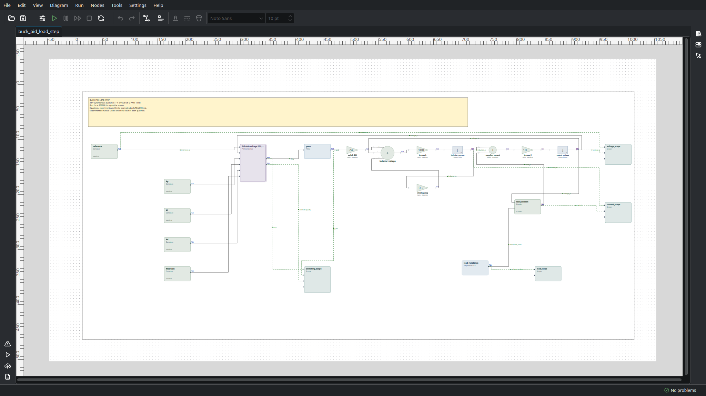

# S7

S7 is a platform for building, running and observing distributed causal systems: signal processing, software-defined radio, distributed sensing, simulation of dynamic systems. A system is a schema of elements and connections. It is validated, compiled into an executable graph and stepped by headless runtime nodes, which may sit on different machines and exchange typed data streams. Studio is an optional GUI for drawing diagrams, deploying them to nodes and watching them run.

Studio models dynamics as explicit networks of integrators, gains, summing
junctions and delays, following the analog-computer approach that inspired S7.
Forward and backward Euler are separate educational elements; the built-in
help explains their recurrences, initial conditions, trapezoidal integration
and the relation between the s and z planes, with MIT and Siebert references.

See [the screenshot tour](screenshots/README.md) for actual runs of a Lorenz
attractor, a controlled buck converter and an AM detector. Public sound/SDR
modules provide independent PortAudio, native PipeWire and SoapySDR backends;
their current execution profile is documented in the
[hardware I/O guide](s7l2/docs/HARDWARE_IO.md).

Causality comes before clock time: the result of a schema is defined by its graph, not by the timing of the machines that run it. Network boundaries are explicit elements, and nodes trust each other through X.509 identities over mutual TLS.

The project is in pre-MVP development. APIs, file formats and protocols may still change without backward compatibility.

## Repository

| Directory | Content |
|---|---|
| [`doc/`](doc/README.md) | Language-neutral documentation: vision, formal model, architecture, terminology, architectural decisions, and the control and data-stream protocols that every implementation speaks |
| [`s7l2/`](s7l2/README.md) | C++26 reference implementation: core model and compiler, headless runtime `s7runtime`, transport and lossless data streams, `s7ctl` command-line tool, element plugins, and the Qt6 Studio. Builds on Linux, and cross-builds for Windows on Linux |
| [`s7py/`](s7py/README.md) | Minimal headless node in Python (standard library only): the control protocol, deployments over mTLS, data streams with other nodes, and execution of a subset of the built-in elements, F64 only |
| [`s7java/`](s7java/README.md) | Minimal data node in Java (standard library only, Java 21+): the data stream wire format and lossless delivery over mTLS, and its part of a deployed diagram, F64 only. It has no control plane yet: its part comes from a deployed diagram file |

The implementations interoperate through the protocols in `doc/`. Their conformance data lives in `s7l2/s7runtime/tests/fixtures/` (control protocol) and `s7l2/s7transport/tests/fixtures/` (wire format). For example, Studio or `s7ctl` can deploy a diagram to a Python node.

## Where to start

- See Studio running three bundled examples: [screenshots and descriptions](screenshots/README.md), including Scope and Live Oscilloscope views.
- Build on Ubuntu 26.04/26.10 or Fedora 45: [dependency installers and options](s7l2/docs/BUILD_DEPENDENCIES.md).
- Study the mathematical blocks: [symbol notation](s7l2/docs/DIAGRAM_SYMBOLS.md) and [integrators, delays and s/z maps](s7l2/docs/INTEGRATORS.md).
- What S7 is and why: [`doc/S7_VISION.md`](doc/S7_VISION.md), then [`doc/S7_Formal_Model.md`](doc/S7_Formal_Model.md).
- Build and run the C++ runtime and Studio: [`s7l2/README.md`](s7l2/README.md), with its docs index in [`s7l2/docs/INDEX.md`](s7l2/docs/INDEX.md).
- Run a Python node: [`s7py/README.md`](s7py/README.md).
- Write another implementation: [`doc/S7_Control_Protocol_MVP.md`](doc/S7_Control_Protocol_MVP.md) and [`doc/S7_Network_Wire_Protocol_v1.md`](doc/S7_Network_Wire_Protocol_v1.md).

## License

S7 is free software. Studio, `s7ctl`, the tests, tools and `s7py` are licensed under the GNU General Public License, version 3 or later ([`LICENSE`](LICENSE)). The runtime and the plugin SDK (`s7core` and the libraries `s7runtime` is built from) are licensed under the GNU Lesser General Public License, version 3 or later, so element plugins and applications that embed the runtime may use any licence. Documentation is CC-BY-4.0; example models and protocol fixtures are CC0-1.0. Diagrams and results you create with S7 are your own.

Details, including the plugin permission and third-party components: [`LICENSING.md`](LICENSING.md).

## Development with AI tools

This project was developed with the help of Claude, GitHub Copilot and Codex. The authors will continue to use AI tools to develop faster and to make the software better.

Many thanks to the companies and engineers who build these AI tools: they make development a real pleasure.
