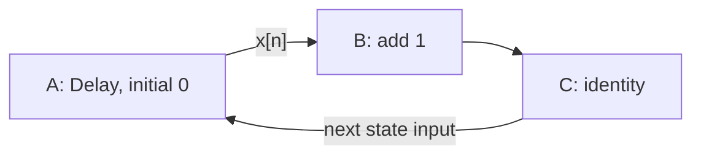

# Cross-node causality: experimental design and findings

Status: initial scheduling spikes, 2026-11-17, followed by
[Phase 2](CROSS_NODE_CAUSALITY_PHASE2.md). No production scheduling approach or
X1 ADR is accepted. The measurements below retain the original transport
baseline; Phase 2 corrects its local ACK defect and adds actual three-host S7
WebSocket/mTLS experiments. The opt-in C++ executable changes only its own
compiled graph records; compiler/runtime scheduling rules remain unchanged.

The [literature record](CROSS_NODE_CAUSALITY_RESEARCH.md) gives full citations,
consulted sections and reading limitations. The [compact evidence](CROSS_NODE_CAUSALITY_SPIKE_SUMMARY.json)
records source/binary/result hashes and measured outcomes. Raw results/logs
remain outside Git. The [0.2.0 matrix](RELEASE_0.2.0_WORKPLAN.md#status-and-acceptance-matrix)
still keeps X1–X3 open.

## Questions and scientific basis

1. **Does crossing a stream initialize feedback?** L1, Lee–Seshia §6.3,
   Example 6.9, and L3, *Dataflow* §3.1.2, distinguish an explicitly initialized
   delay from a channel carrying a sequence. The hypothesis tested here is
   that transport adds no model sample: `Delay` supplies the state. This is an
   S7 interpretation to record in X1, not a network property inferred from
   physical latency. [Textbook](https://ptolemy.berkeley.edu/books/leeseshia/releases/LeeSeshia_DigitalV2_2.pdf),
   [feedback chapter](https://ptolemy.berkeley.edu/books/Systems/chapters/Dataflow.pdf).
2. **Does a valid whole graph imply a runnable partition?** L7, Pino et al.
   §5, shows that clustering can introduce deadlock. We therefore test the
   graph's causal dependencies separately from the node worker's operation
   order. These fixtures do not implement or prove that report's general
   composition theorem. [Report](https://ptolemy.berkeley.edu/publications/papers/95/erl-95-36/erl-95-36.pdf).
3. **Does readiness alone solve admission?** L8, Zhou–Lee §§1–2, relates
   input/output dependencies through composition. Readiness may enable a
   legal firing but does not make an uninitialized cycle legal. Preserve
   path-level causality and S7's causal-memory classification, including
   flattened nested schemas. [Paper](https://ptolemy.berkeley.edu/publications/papers/06/causalityInterfaces_EMSOFT06/CausalityInterfaces_EMSOFTpaper_ZHOU.pdf).
4. **Do bounded queues change progress?** L4's process-network model has
   conceptually unbounded channels/nonblocking writes. L5, Parks §4.2, studies
   artificial deadlock from finite capacities; L6's published abstract warns
   of limits to that scheduling policy. T2, Stanford EE382C lecture 6,
   slides 1–14, supplies a resource/wait-for analysis vocabulary. S7 needs
   evidence for queue credits, not just data dependency ordering.
   [L4](https://ptolemy.berkeley.edu/publications/papers/95/processNets/proceedings.pdf),
   [L5](https://ptolemy.berkeley.edu/publications/papers/95/parksThesis/thesis.pdf),
   [L6 publication record](https://research.tue.nl/en/publications/requirements-on-the-execution-of-kahn-process-networks/),
   [Stanford lecture](https://web.stanford.edu/class/ee382c/lectures/06_deadlock.pdf).
5. **Is a global physical clock required for this experiment?** No such
   assumption is made: logical sample indices and dependency order are used.
   L9's send-before-receive relation and T1, MIT Classes 11–12, distinguish
   causality from physical time and explain why deadlock diagnosis needs
   process/channel state. Startup orchestration is not a per-step barrier.
   [Lamport](https://lamport.org/pubs/time-clocks.pdf),
   [MIT notes](https://ocw.mit.edu/courses/6-852j-distributed-algorithms-fall-2009/pages/lecture-notes/).

## Approaches compared

| Approach | Experiment | Implementation boundary |
| --- | --- | --- |
| Fixed local order | Execute the local topological schedule serially, waiting at its next stream operation. | Logical model; the C++ fixture uses the actual compiler's order; the TCP control deliberately places receive before send. The TCP control is not a generated S7 schedule. |
| Projected global order | Expand a same-step causal order with send/receive events and project it onto each node. | Logical model; C++ ranks its restricted fixture's stream events after the unpartitioned reference producer; TCP uses the corresponding hand-derived order. Not a general distributed compiler. |
| Readiness-based order | Within one node step, select a dependency-ready operation whose input/credit is available; defer blocked operations. | Logical model and TCP fixture only. No resumable `NodeRuntime` implementation exists in this spike. |

Each node owns its computation serially. Network I/O threads transfer data
and credits. Experiments use explicit memory, one rate and one F64 value per
stream/sample. Memory publication and next-state staging are separate phases.
There is no global ODE solver, within-node worker pool, implicit sample hold
or automatic delay insertion.

The three-host feedback reference is:



Thus `x[0]=0`, `x[n+1]=x[n]+1`; A receives `n+1`, B receives `n`, and C
receives `n+1`. An independent-stream ring sends constants `2,3,5` instead:
the physical topology is cyclic but there is no element-level feedback.
These closed-form references are independent of the scheduling algorithm.

## Measurements

### Deterministic logical model

Ten cases × three capacities (`1,2,8`) × three slow-node opportunity periods
(`1,3,7`) × four insertion permutations × three approaches give **1,080 runs
per host**, repeated on the development host, `win` and ARM64 `mail`:
**3,240 runs total**, identical detailed outcomes and runner hashes. Cases
include feedforward flow, memory on either node, an explicitly
flattened memory path, independent bidirectional streams, feedback fan-out,
three invalid-cycle controls, and an added-stream-delay control.

For each host's matrix:

| Approach | Completed with matching reference | Rejected before scheduling | Deadlocked |
| --- | ---: | ---: | ---: |
| Fixed local order | 72 | 0 | 288 |
| Projected order | 252 | 108 | 0 |
| Readiness-based order | 252 | 0 | 108 |

The 108 invalid cases are an uninitialized cycle, stateful direct feedthrough
mistaken for memory, and a direct cycle with memory elsewhere in the same SCC.
Readiness does not reject them: it stalls. Admission validation remains
necessary. Fixed ordering also stalls on 180 causally valid configurations.

The extra-stream-delay control is intentionally a changed graph. Instead of
the original counting sequence `1,2,3,4,...`, it produces `1,1,2,2,...`.
Its ability to run is not evidence for silently adding transport memory.

Queue capacity was never exceeded. Opportunity periods are synthetic scheduling
choices, not measured physical node rates. Probe/check counts include diagnostic
readiness checks and must not be read as production CPU performance.

### Actual C++ runtime and existing in-memory transport

Four shapes: memory on A, memory on B, a real nested schema containing `Delay`,
and independent opposite-direction streams. Each is checked against an
unpartitioned `NodeRuntime` and the closed-form output. One baseline per shape
and six projected variants (windows `1,8,64`, with/without a 1 ms slow worker)
give 28 configurations. Two additional 55 ms pacing controls give
**30 runtime configurations**, plus **two graph-free credit probes**.

| Configuration | Observed result |
| --- | --- |
| Current compiler order, 4 baseline cases | Both nodes stop at step 0 with `UNDERRUN`; recorded orders put a blocking incoming read before the ready outgoing publication. |
| Projected order, window 1, 8 cases | Both nodes reach 2 steps, then report send-log overflow/receive underrun. All sampled completed-step prefixes match the reference. |
| Projected order, window 8, 8 cases | Both nodes reach 9 steps, then report the same faults; prefixes match. |
| Projected order, window 64, 8 cases | Both nodes complete 32 steps with exact reference outputs. This window does not exercise long-run saturation. |
| Projected order, windows 1 and 8, B paced at 55 ms, 2 controls | Both nodes complete 32 steps with exact outputs. This is an ACK-timing control, not a proposed pacing requirement. |
| Unpartitioned delay-free negative control | Existing validator refuses it. |

The graph-free probe opens one producer/consumer pair, publishes one value,
then consumes it before publishing the next. With a one-packet window,
consumption of value 1 empties the send log; consumption of value 2 leaves
one logged packet; publishing value 3 returns `SEND_LOG_OVERFLOW`. The first
two values are consumed within 39 microseconds in the recorded run. A separate
probe waits 55 ms between values; all three values are consumed and the log
returns to zero each time. Thus neither graph ordering nor a blocked consumer
is required to reproduce this failure.

Source inspection explains the timing: the in-memory scalar endpoint's
[`transfer`](../s7transport/src/transport.cpp) requests `ack_due(now + kAckInterval)`;
[`ack_due`](../s7transport/src/stream_protocol.cpp) stores that future argument
as `last_ack_`. Later burst consumption is still gated by the interval, and
this endpoint has no independent ACK timer to release that credit while the
graph waits. The 50 ms interval and the two controls support this attribution.
The receive-after-starvation path also merits separate coverage, but it is
not needed for the graph-free reproduction.

At this stage no production fix had been applied. Phase 2 now records the
correction, regression and rerun; this table remains historical evidence.
Larger buffers only hide saturation within this run. The original 28-configuration matrix was repeated
without concurrent builds; the final expanded runner reproduces those
outcomes. See the compact evidence for repeat equivalence.

### Three physical hosts

A: Fedora 45 x86-64 development host; B: `win`, running Fedora 45 x86-64;
C: `mail`, Linux aarch64 (kernel `6.18.60-current-rockchip64`, glibc 2.41).
The hostname `win` does not mean a Windows run. Only Python standard-library
spikes are copied to remote temporary directories; no compiler is required.

Two topologies × three approaches × windows `1,8` × C delay `0,5 ms` give
**24 configurations / 72 node runs**, each targeting 32 logical steps.

| Approach | Result across both topologies, windows and speeds |
| --- | --- |
| Receive-first control | All 8 configurations time out before any data publication (24 node runs). This is a deliberately constructed wait cycle, not timeout-based inference about an arbitrary graph. |
| Projected order | All 8 configurations complete, 32 samples per host, exact references and bounded credit/receive counts. |
| Readiness-based order | All 8 configurations complete with the same checks. |

Application queues and consumption-credit windows are fixed. SSH tunnels bind
only loopback; A→B crosses to `win`, B→C is relayed through the development
host to `mail`, and C→A returns directly through its tunnel. Latency therefore
includes SSH and that extra relay. No latency/throughput ranking is claimed.

This is a small TCP/JSON fixture with immediate consumption credits. It is not
the S7 wire protocol, TLS/capability conformance or deployed-runtime acceptance.
It does not exercise packet batching, delayed ACK policy, reconnect, faults,
recovery, independent hardware clocks or physical SDR/audio I/O. It cannot
override the tighter-window failure observed in the real C++ transport.

## Reproduction

Use fresh output names; the Python runners refuse to overwrite results.

```sh
python3 -B tools/cross_node_scheduling_spike.py --output /tmp/s7-causal-model.json

cmake -S . -B /tmp/s7-causal-build -DCMAKE_BUILD_TYPE=Release -DS7_BUILD_STUDIO=OFF
cmake --build /tmp/s7-causal-build --target s7tests_cross_node_scheduling_spike --parallel 2
/tmp/s7-causal-build/s7tests/s7tests_cross_node_scheduling_spike > /tmp/s7-causal-runtime.json

# Hosts must already be accessible using the expected SSH host keys.
python3 -B tools/run_cross_node_tcp_spikes.py \
  --host-b win.local --key-alias-b win \
  --host-c mail.local --key-alias-c mail \
  --output /tmp/s7-causal-three-hosts.json
```

The C++ research target is excluded from normal builds, `build-tests` and
CTest; it reports hypothesis failures as experimental outcomes. Reference
mismatches or malformed fixtures fail the executable. Remote tests use only
their own `/tmp` directories and temporary SSH forwards, which are closed by
the orchestrator. No tests write under `$HOME` or open hardware.

## Conclusions and next spikes

The evidence supports separating **causal validation**, **node operation
ordering**, and **transport-credit progress**. It does not select a production
scheduler. Projected order is a promising narrow option for the existing
single-rate serial executor; readiness is a useful alternative with additional
suspension/state requirements. Both require explicit error/side-effect rules:
reordering publications can change which external effects occur before a later
fault, even when successful pure-graph outputs agree (ADR-021).

Before deciding X1/X2 implementation:

The first two follow-up experiments below have since been carried out in
[Phase 2](CROSS_NODE_CAUSALITY_PHASE2.md); its conclusion records the current
next prototype. This list preserves the initial research sequence.

1. The tight-window stall is now isolated by the graph-free probes. Compare
   immediate and timer-driven consumption ACK progress and packet batching on
   actual S7 endpoints, retaining those controls. A correction should preserve
   consumption-based ACKs and have its own transport regression before any
   production adoption; increasing buffers or slowing the graph is not a fix.
2. Repeat the chosen scheduling prototype on actual S7 transports across all
   three hosts, using independent credentials and explicit data policies.
   The TCP/JSON fixture is research evidence only.
3. Define admission and the supported actor subset, causal-memory initialization,
   immutable schedule/revision distribution, failure-prefix behavior and restart
   semantics. Cite L1/L3/L7/L8 at those decisions. Keep multirate feedback,
   coupled numerical regions and arbitrary side-effecting/plugin actors outside
   any claimed proof until specifically investigated.

X1 is in research; X2/X3 release implementation and acceptance remain open.
