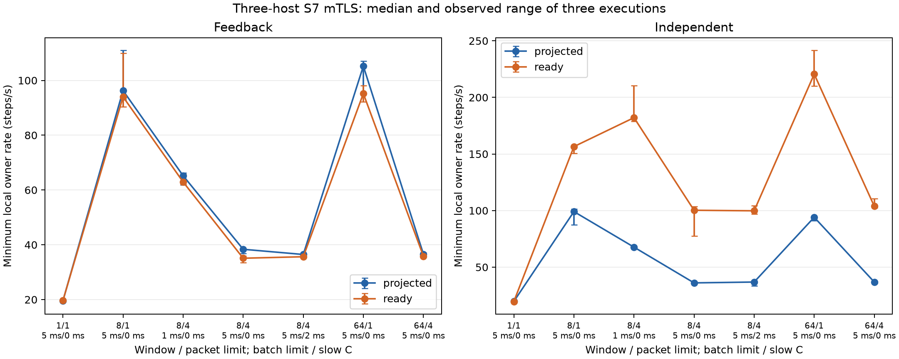
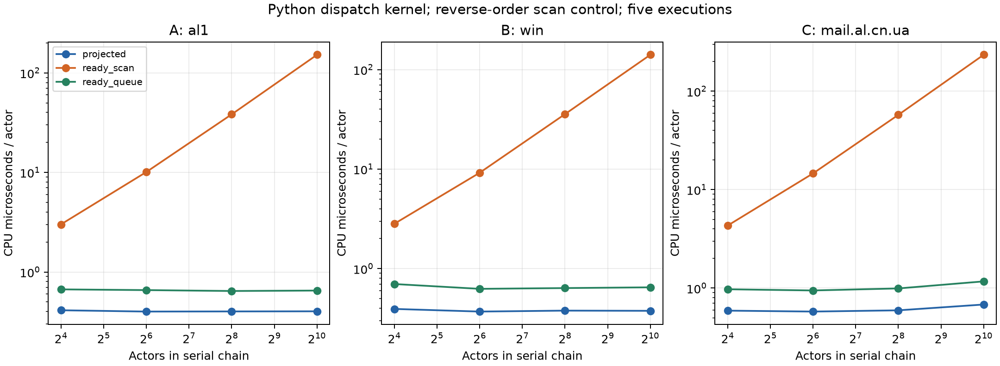

# Cross-node scheduling: derived plans and performance

Research round started 2026-11-17, continuing the
[real-transport experiments](CROSS_NODE_CAUSALITY_PHASE2.md). This is an opt-in
prototype; no production compiler, runtime, wire contract or X1 ADR changes.
The subsequent [Phase 4 comparison](CROSS_NODE_CAUSALITY_PHASE4.md) measures
outgoing-first static ordering and incremental readiness in remote Python and
local C++ fixtures, with ordinary runtime and polling-cost controls.

## Design and sources

The research planner expands placed scalar actors into computation,
send/receive, explicit memory-publication and memory-commit tasks. Remote
receives depend on their corresponding send. A node's memory commits follow
its causal phase; memory publication has no current-input dependency. This
preserves the distinction between initialized state and transport buffering
in Lee–Seshia §6.3 and the Ptolemy *Dataflow* chapter §3.1.2 (L1/L3 in the
[bibliography](CROSS_NODE_CAUSALITY_RESEARCH.md)). Stateful direct feedthrough
does not cut dependencies. No hidden stream initial sample is added.

A canonical Kahn traversal derives a global same-step order and projects it
onto node owners. Stable task IDs resolve ties, independently of input actor
insertion order. Revalidation adds serial edges from each proposed node order
to the global dependency DAG and rejects a cycle. This addresses partitioning
wait cycles motivated by Pino/Bhattacharyya/Lee §5 (L7), causality interfaces
(L8), and the MIT/Stanford teaching notes (T1/T2). It is not a proof of bounded
runtime liveness, arbitrary multi-rate execution or safe deployment revisions.

The planner accepts only explicitly declared single-rate scalar fixture kinds.
It is not an importer for arbitrary S7 schemas, plugins or nested diagrams.
Cycle diagnostics report a residual set, which can include descendants of a
cycle; they do not claim a minimal cycle path. The production compiler and
deployment preparation remain untouched.

Focused checks cover canonical plans under 32 shuffled actor orders per
topology, local projection membership, unsafe receive-first projections,
delay-free/stateful-direct cycles, malformed actors, fan-out and multiple
memories. These are research checks, invoked directly rather than added to
the production test suite.

## Performance method

Kalibera–Jones (L10), introduction and §6, motivates separating initialization
from measured work and reporting execution variation. This experiment uses
three fresh-process executions per network case, randomizes paired schedule
order with a recorded seed, and discards 64 local warm-up steps before 256
measured steps. This fixed warm-up is not a demonstration of statistical
independence or convergence; correlated step samples are not independent
experimental repetitions. Small differences are not treated as established
speedups. The three-execution median and observed min/max are descriptive
statistics, not confidence intervals.

Timer and instrumentation choices also follow the official
[Google Benchmark guide](https://google.github.io/benchmark/user_guide.html),
especially warm-up, random interleaving and CPU timers, and Python's
[time](https://docs.python.org/3/library/time.html) and
[resource](https://docs.python.org/3/library/resource.html) documentation.
Wall intervals use each host's monotonic performance clock; owner CPU uses
thread CPU time, and total fixture CPU uses process CPU time. CPU excludes
sleep but includes measured instrumentation; process CPU includes the data
I/O thread and TLS work, and excludes the separate SSH processes. There is no
subtraction of clocks belonging to different machines and no one-way network
latency estimate.

Two independent measurements are made:

- **Planning and dispatch scaling on each host.** Serial-chain and wide graphs
  have 16/64/256/1024 actors. Planning plus projection validation is measured
  five times after warm-up; peak planner allocation is measured separately
  with `tracemalloc`. Matched Python arithmetic kernels compare static order,
  readiness scan and dependency-queue dispatch for 16 steps, with five timed
  in-process invocations and exact integer checksums. These are not independent
  process repetitions. The scan deliberately uses reversed
  topological pending order, an adverse control. The queue resets dependency
  counts each step; static order amortizes planning. This is not C++
  `NodeRuntime` throughput or a network-readiness queue implementation.
- **Real three-host transport.** A/B/C use the same instrumented Python
  computation and unchanged `s7py` StreamTable/DataEndpoint implementation,
  actual binary wire messages and mTLS. Only dispatch selection differs:
  derived projected order versus local readiness scanning. Derived plan,
  source and certificate hashes must match on every role. Computation remains
  on one owner per node with independent I/O ticks. Thus language differences
  from Phase 2's mixed C++/Python experiment do not enter this comparison.

Network profiles vary send-log windows 1/8/64, packet limits 1/4, batch limits
1/5 ms, and C's injected per-step delay 0/2 ms. Seven selected profiles over
two topologies and two schedules, each repeated three times, give 84 normal
runs. Two receive-first negative controls and two actual disconnect/reconnect
controls are reported separately. Neither negative timeouts nor reconnection
timings are folded into the normal throughput comparison.

Reported per-node metrics include measured throughput, p50/p95/p99 step wall
duration, owner/process CPU per measured step, condition waits, readiness
probes, send/receive wall intervals, injected delay, context switches and
ACK-drain time. Receive/send wall time includes both active work and waiting;
it is not a pure blocking counter. In readiness mode much waiting moves to
the scheduler's condition variable, so a smaller receive interval alone is
not a speedup. All-node rate is conservatively summarized as the minimum
local owner rate, not a synchronized global makespan. ACK drain is separate
from the measured computation interval.

Step percentiles use 256 samples per owner and nearest-rank quantiles; the
p99 is sensitive to a few observations and is not a real-time guarantee.

Packet fill and transport blocked time use end-of-run counters including
warm-up and drain. Buffer/log peaks are sampled once per completed step,
not exact event-level peaks. RSS is each process's lifetime peak (Linux KiB),
including imports/setup, not memory allocated only during measurement.
Instrumentation and per-step status observation have a cost in both methods.

The hosts are local Fedora x86-64, `win` running Fedora x86-64, and `mail`
running ARM64 Linux. S7 mTLS is end to end inside loopback-only SSH forwards;
C→B uses the controller relay. This measures that route and system load, not
bare-LAN capacity. No services, firewall, CPU governor or host-wide affinity
are altered. No physical sound/SDR devices are opened.

## Observed results

The full run completed **88 configurations / 264 node runs** with the expected
successful and negative outcomes. There were **82,560 exact reference values**
checked, including warm-up; **66,048 values** belong to measured intervals.
Both disconnect controls reconnected and completed 320 values per node; replay
counters advanced. Both receive-first controls stopped at zero steps after
about four seconds. All successful streams ended fault-free with drained send
logs, matching sources/plans/certificates and no unauthorized/malformed traffic.
Temporary remote staging was removed on both hosts.

The [machine-readable summary](CROSS_NODE_CAUSALITY_PHASE3_SUMMARY.json) contains
all planning/CPU cases, paired ratios, identities and source/result hashes.
The [per-node CSV](CROSS_NODE_CAUSALITY_PHASE3_CASES.csv) includes each execution,
including controls, CPU, waits, context switches, RSS and ACK drain. Previous
rounds remain separate; no result is silently replaced with a new source hash.



The tables report the median across three executions and the observed rate
range. P95/P99 are the median of each run's worst owner percentile. CPU is the
**sum of all three processes' CPU microseconds per local measured step**;
it is not elapsed time or pure arithmetic cost. P/R means projected/readiness.
Packet fill is values per data packet, including warm-up/drain. For individual
host costs and every metric, use the CSV rather than these aggregate columns.

### Feedback

| Window / packet / batch ms / C delay ms | Projected steps/s [range] | Ready steps/s [range] | P95 ms (P / R) | P99 ms (P / R) | CPU µs/step (P / R) | Packet fill (P / R) |
| --- | --- | --- | --- | --- | --- | --- |
| 1 / 1 / 5 / 0 | 19.6 [19.3–19.7] | 19.7 [19.6–19.8] | 61.8 / 57.6 | 100.0 / 82.5 | 19798.2 / 17965.9 | 1.00 / 1.00 |
| 8 / 1 / 5 / 0 | 96.3 [93.0–111.0] | 94.0 [90.4–109.9] | 13.8 / 13.9 | 16.4 / 17.6 | 6744.6 / 8363.7 | 1.00 / 1.00 |
| 8 / 4 / 1 / 0 | 65.2 [61.9–66.3] | 62.9 [62.0–65.7] | 18.8 / 19.5 | 31.7 / 38.0 | 11133.1 / 11055.6 | 1.00 / 1.00 |
| 8 / 4 / 5 / 0 | 38.4 [36.8–38.5] | 35.1 [33.5–35.9] | 29.6 / 33.0 | 52.9 / 68.2 | 10721.2 / 16537.6 | 1.00 / 1.00 |
| 8 / 4 / 5 / 2 | 36.5 [36.3–36.5] | 35.6 [35.3–36.5] | 32.0 / 31.7 | 64.4 / 73.5 | 16003.5 / 16161.0 | 1.00 / 1.00 |
| 64 / 1 / 5 / 0 | 105.2 [95.1–107.1] | 95.2 [92.2–98.1] | 12.7 / 13.9 | 33.8 / 18.7 | 5734.2 / 8029.3 | 1.00 / 1.00 |
| 64 / 4 / 5 / 0 | 36.6 [36.4–37.0] | 35.8 [35.4–37.2] | 31.7 / 32.4 | 64.1 / 66.0 | 14581.8 / 15159.0 | 1.00 / 1.00 |

### Independent

| Window / packet / batch ms / C delay ms | Projected steps/s [range] | Ready steps/s [range] | P95 ms (P / R) | P99 ms (P / R) | CPU µs/step (P / R) | Packet fill (P / R) |
| --- | --- | --- | --- | --- | --- | --- |
| 1 / 1 / 5 / 0 | 19.7 [19.7–19.8] | 19.7 [19.6–19.7] | 57.2 / 58.4 | 78.7 / 94.6 | 17550.2 / 27644.1 | 1.00 / 1.00 |
| 8 / 1 / 5 / 0 | 99.1 [87.3–101.3] | 156.5 [150.7–156.9] | 13.3 / 20.9 | 24.0 / 24.3 | 7746.0 / 5831.9 | 1.00 / 1.00 |
| 8 / 4 / 1 / 0 | 67.7 [67.2–67.9] | 182.1 [178.8–210.4] | 18.7 / 18.0 | 30.0 / 21.7 | 9688.5 / 4017.7 | 1.00 / 2.94 |
| 8 / 4 / 5 / 0 | 36.1 [36.1–36.9] | 100.3 [77.7–103.5] | 31.8 / 30.6 | 64.5 / 58.0 | 15668.4 / 6408.0 | 1.00 / 2.95 |
| 8 / 4 / 5 / 2 | 36.8 [33.6–37.7] | 99.8 [96.8–104.2] | 31.1 / 30.3 | 64.3 / 31.8 | 15353.6 / 6209.7 | 1.00 / 2.36 |
| 64 / 1 / 5 / 0 | 94.1 [91.1–94.2] | 220.6 [210.1–241.7] | 14.5 / 13.0 | 23.1 / 18.6 | 8366.6 / 4618.3 | 1.00 / 1.00 |
| 64 / 4 / 5 / 0 | 36.9 [35.7–37.5] | 103.9 [102.5–110.4] | 31.8 / 29.0 | 72.5 / 38.0 | 12243.5 / 4741.7 | 1.00 / 2.90 |

### Planning and dispatch scaling



At 1,024 actors, median planning plus validation and dispatch costs were:

| Host / shape | Plan + validate ms | Planner peak KiB | Static CPU µs/actor | Scan CPU µs/actor | Queue CPU µs/actor |
| --- | --- | --- | --- | --- | --- |
| A / chain | 5.44 | 933.1 | 0.403 | 152.033 | 0.651 |
| A / wide | 4.73 | 853.2 | 0.336 | 0.731 | 0.493 |
| B / chain | 5.66 | 933.1 | 0.376 | 140.970 | 0.648 |
| B / wide | 4.99 | 853.2 | 0.302 | 0.681 | 0.472 |
| C / chain | 10.60 | 933.1 | 0.681 | 234.780 | 1.170 |
| C / wide | 9.33 | 853.2 | 0.522 | 1.130 | 0.825 |

Host A is the local Ryzen 7 4700U/Python 3.15.2, B is `win`'s Intel N100/Python
3.15.2, and C is `mail`'s ARM64/Python 3.13.5. These are within-host method
comparisons; differing machines/interpreters do not isolate CPU architecture.
All 24 size/shape/host cases have full measurements in the JSON summary.
The four admission cases per host also record acceptance/rejection timing.

At 1,024 chain actors, the adverse scan performs 524,800 readiness probes per
step; the dependency queue performs 1,023 dependency decrements and dispatches
each actor once. Static dispatch and the queue retain approximately constant
CPU cost per actor over this sweep, while scanning grows sharply. This is
strong evidence against repeatedly rescanning a pending actor vector in the
hot path. The measured queue is still roughly 1.6–1.7 times the static kernel's
CPU cost in the largest chain. Neither cost is a measured C++ runtime cost.

### Interpretation and next prototype

1. **A valid static projection can serialize independent work unnecessarily.**
   In the independent fixture, the canonical projection puts B's independent
   send after its incoming read and C's send after its incoming read. This is
   acyclic but creates a serial communication path. Readiness skips an
   unavailable read and can publish already-computable values. With window 8,
   packet limit 4 and batch limit 5 ms, median rates are 36.1 versus 100.3
   steps/s; the paired readiness/projected rate ratio ranges 2.11–2.87
   (median 2.78). Packet fill rises from 1.00 to about 2.95. This is a result
   for these fixtures, route and implementations, not a universal speedup.
2. **Readiness does not remove causal feedback latency.** For feedback with
   window 8 and one-value packets, median rates are 96.3 versus 94.0 steps/s,
   with overlapping execution ranges. There is no basis here to choose a
   universal winner. With four-value packets every feedback packet still
   contains exactly one value: the explicit initial state permits one trip
   around the loop, not future values that could fill a batch. At a 5 ms batch
   limit, medians fall to 38.4/35.1; reducing that limit to 1 ms gives 65.2/62.9.
   Increasing the window to 64 does not repair a partially filled feedback
   batch. No extra delay/sample is introduced as a performance shortcut.
3. **Credit and timers must be budgeted separately from scheduling.** Window 1
   with one-value packets limits both methods to roughly 19.7 steps/s across
   both workloads, consistent with consumption ACK timing. Window 8 or 64
   helps one-value workloads substantially. These intentionally small windows
   are resource controls, not the production default or recommended settings.
   The network's ACK policy was held unchanged; the earlier isolated ACK
   experiment supplies the policy comparison.
4. **Where time is charged matters.** In the window-8/four-value/5-ms feedback
   case, summed process CPU is 10.72/16.54 ms per step, owner CPU 1.30/2.89 ms,
   and selection CPU 0.038/0.759 ms. Readiness averages about 50.5 probes and
   11.8 condition waits per distributed step. In the equivalent independent
   case, readiness instead lowers process CPU from 15.67 to 6.41 ms and owner
   CPU from 1.83 to 1.60 ms while increasing throughput. Additional scheduler
   work can be offset by fewer waits/packets; wall time and CPU must both be
   measured. A smaller receive-call interval alone would hide scheduler waits.

The next comparison should measure a **derived static order that prioritizes
ready outgoing work**, revalidated against the full precedence graph, against
an **incremental readiness queue**. The first may retain inexpensive serial
dispatch without the canonical order's avoidable serialization; the second
must avoid the demonstrated scan cost and define I/O wakeups, state ownership
and commit behavior. These are hypotheses for the next experiment, not tested
performance claims or an accepted production design.

Before production selection, repeat the matched comparison in C++ `NodeRuntime`
with realistic actor costs and block workloads, direct LAN routes, longer
measurements and representative fan-out/slow consumers. The present numbers
are scalar Python/SSH-fixture performance; they do not qualify C++ DSP, audio,
SDR, real-time deadlines, arbitrary graphs or release deployment. X1–X3 and
schedule distribution/revision/failure-prefix contracts remain open.

## Reproduction

```sh
python3 -B tools/test_cross_node_schedule_plan.py
python3 -B tools/cross_node_schedule_plan.py --benchmark --output /tmp/cpu.json
python3 -B tools/run_cross_node_s7_perf.py \
  --host-b win.local --key-alias-b win --python-b /path/to/win/venv/bin/python \
  --host-c mail.local --key-alias-c mail \
  --steps 256 --warmup 64 --repetitions 3 \
  --output /tmp/s7-performance.json
python3 -B tools/summarize_cross_node_perf.py /tmp/s7-performance.json \
  --summary /tmp/s7-performance-summary.json --csv /tmp/s7-performance.csv \
  --figures /tmp/s7-performance-figures
```

The runner refuses an existing output file. Use `--smoke` for four small
transport cases and shorter local CPU checks. Python executables need
`cryptography`; the reporter's optional figures need Matplotlib. Runtime
Python sources come from the sibling `s7py/s7node` checkout. Fresh temporary
credentials are scoped per role, with the CA private key only in controller
memory, and staging is removed at the end. Historical Phase 1/2 artifacts and
source hashes are preserved separately.
