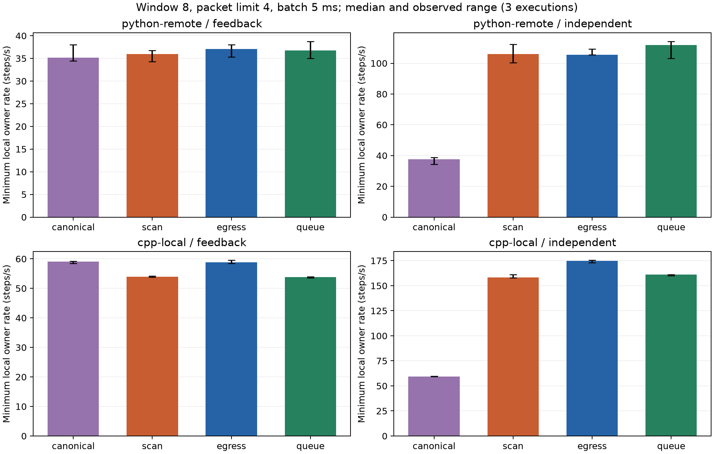
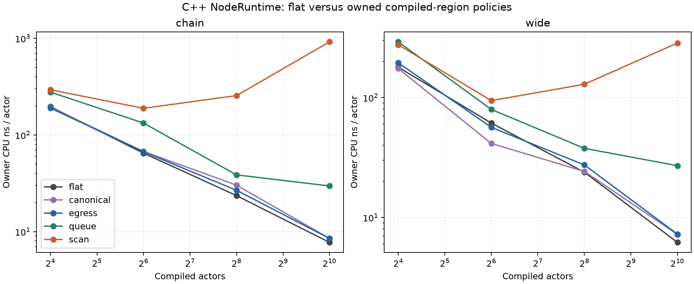

# Outgoing-first static schedules and incremental readiness

After this research, the maintainer authorized implementation of the strongest
candidate. [ADR-027](../../doc/S7_Architectural_Decisions.md#adr-027) and the
[implementation guide](DISTRIBUTED_CAUSAL_SCHEDULE.md) record that subsequent
change. The experiments and source/result identities below remain historical.

Research round started 2026-11-17, following the
performance findings. The production compiler,
runtime API, network protocol and deployment path are unchanged. All new
executables and scripts are opt-in research fixtures; X1–X3 remain open.

## Candidates and scientific basis

The previous canonical projection was correct but serialized independent sends
behind unrelated receives. The new static candidate chooses an eligible send
first, then ordinary computation/memory publication, then receives, then the
memory barrier/commit phase. Eligibility still comes from the complete global
precedence DAG. The resulting node orders are revalidated by adding their
serial edges to that DAG and checking for a cycle. This follows the
partitioning concern in Pino/Bhattacharyya/Lee §5 (L7), rather than assuming
that any partition of a valid graph must make progress.

The incremental queue precomputes local dependency counts and followers. A
completed task decrements only its followers' counts; each compute task becomes
eligible once per step. Unavailable stream operations enter a separate blocked
I/O list. Waking for I/O revisits that list, not every compute actor. There is
one execution owner per node. No receive invents a value or skips sequence
positions, and explicit memory still publishes before computation and stages
after it. Lee–Seshia/Ptolemy (L1/L3), causality interfaces (L8), and the
MIT/Stanford material (T1/T2) motivate these boundaries. Full sources and
reading limits are in the [research bibliography](CROSS_NODE_CAUSALITY_RESEARCH.md).

These are single-rate scalar actor plans, not a general S7 schema importer.
Acceptance of a projected order does not establish arbitrary bounded-channel,
fan-out, multi-rate or revision-transition liveness. No new stream initial
token, implicit delay, global clock barrier or global equation solver is added.

## C++ execution and ownership

The C++ fixture compiles actual `Constant`, `Gain`, `Adder`, `NetSource` and
`NetSink` elements. A research region owns the compiled elements and dispatches
them under the selected policy. It exposes **every inner output's owned
storage** to its outer `NodeRuntime`, so the normal runtime snapshots and
restores every output if the region throws. `NodeRuntime` owns the explicit
boundary `Delay`, including publication, staging and step count. Region
failure notification is forwarded to inner elements. A focused injected-fault
check verifies restoration of all inner outputs and exact memory retry for
canonical, outgoing-first, scanning and queue policies.

This adapter is not a production resumable `NodeRuntime` API, numerical trial
region, schema-library element or deployment feature. Only the closed fixture
is supported. External network effects remain outside local output rollback,
as specified by [ADR-021](../../doc/S7_Architectural_Decisions.md#adr-021).
An ordinary flat `NodeRuntime` control measures adapter/instrumentation cost.
The static and queue comparisons themselves use the same owning region and
the same compiled elements; the expensive adapter is not charged only to one
candidate.

Streams are preopened identically for all C++ network policies. A narrow
fixture endpoint adapter lets each real `NetSource`/`NetSink` claim its known
handle once. Peer identity, binary wire, batching, ACKs and faults remain in
the existing Beast backend. It serves data only, using fresh mTLS credentials.

The public C++ endpoint has **no readiness/wakeup subscription**. Consequently
this prototype inspects public stream status for I/O readiness and sleeps
between unsuccessful checks. It polls stream operations rather than scanning
compute actors. The normal poll interval is 1,000 µs; a matched 50 µs control
measures its latency/CPU tradeoff. Status acquisition, allocation, locks,
sleep/wakeup and queue management are included in the measurements. A production
queue must resolve this interface limitation; its cost cannot be inferred from
the pure CPU kernel alone.

## Measurements and verification

The methodology retains the separation of wall time, owner CPU and process CPU
from Phase 3, motivated by Kalibera–Jones (L10) and the linked official timer
documentation. Each network case has three fresh-process executions, 32 local
warm-up steps and 128 measured steps. Pair/block order is randomized with a
recorded seed. Fixed warm-up does not establish statistical independence.
Medians and observed ranges are descriptive; there are no confidence intervals
or real-time tail guarantees. Nearest-rank p99 over 128 samples is particularly
sensitive to isolated observations.

The two network environments are deliberately reported separately:

- **Python over three physical hosts:** local Fedora, `win` on Fedora and
  `mail` on ARM64 Linux. The same Python worker and unchanged `s7py` endpoints
  run on every role. The previous loopback-only SSH forwards/controller relay
  carry end-to-end S7 mTLS. Python readiness waits on the existing transport
  condition variable, with a bounded periodic recheck.
- **C++ over three local processes:** all three roles use the same C++ binary,
  real compiled elements, `NodeRuntime`, Beast WebSocket/mTLS and explicit
  state. These are loopback routes on one physical host. They establish a
  matched C++ policy comparison, not a cross-language speedup over the remote
  Python experiment or qualification of remote ARM64 C++ binaries.

Each environment compares outgoing-first and incremental queue policies across
both feedback and independent streams, windows 1/8/64, packet limits 1/4,
batch limits 1/5 ms and a separate 64-actor outgoing-chain workload. Canonical
static and scan controls are repeated in the original window-8/packet-4/batch-5
profile. The Python matrix adds receive-first failures and actual connection
closure/reconnect. The C++ matrix adds ordinary flat-runtime and 50 µs poll
controls. All normal cases check every value against the independent recurrence
or constant reference, source/plan/certificate identity, drained credits,
stream faults and sampled log bounds. Queue dispatch and dependency-update
counts are independently checked against the imported graph.

The C++ CPU matrix has chain/wide graphs with 16/64/256/1024 actual compiled
actors and five methods: ordinary flat runtime, wrapped canonical/static,
wrapped outgoing-first, queue and scan. There are three fresh processes per
cell, 32 warm-up steps and at least 65,536 measured actor dispatches (128 steps
minimum). Every output reference and wrapped dispatch count is checked. The
scan is an adverse fixed-vector traversal, including already-completed flags;
its counters count eligibility probes, not all skipped flag visits. It is not
the same scan implementation as the Python pending-vector control.

C++ per-actor selection clocks are disabled in the measured matrix to avoid
charging two clock reads to every queue operation but none to static dispatch.
Whole-step clocks and structural counters remain enabled. `--selection-timing`
exists for separate diagnostics. Per-step sample/reference recording is common
to all methods. CPU includes this instrumentation and I/O/TLS work, but excludes
the separate SSH processes and compilation/setup. Setup has its own interval:
schema validation/compilation/region construction, ending before the
`NodeRuntime` constructor. RSS is lifetime peak, including setup/imports.
Packet fill and producer blocked time include warm-up/drain; buffer/log peaks
are sampled rather than event-level maxima.

No physical devices, services, firewall, governor or host-wide affinity are
changed. Temporary node keys are removed; the temporary CA private key remains
only in controller memory. Previous experiment sources and results are kept
separate rather than relabelled with new source hashes.

## Results and recommendation

All **184 network configurations / 552 node runs** produced the expected
outcomes: 88 configurations on the three physical hosts and 96 C++
configurations on three local processes. **87,360 exact reference values**
were checked, including warm-up; 69,888 values belong to measured intervals.
The two Python receive-first controls stopped at zero steps. Both injected
connection closures reconnected, replayed and preserved every value. Successful
runs ended without stream faults, identity/framing errors or retained send-log
credit. Queue dispatch and dependency-update counts matched their graph-derived
expectations. All temporary remote payloads were removed.

The final isolated C++ CPU matrix completed **120 fresh-process runs** after
all transport workers stopped. Nine Python planner/queue checks and four C++
publication/memory-retry checks passed. The C++ target built without warnings.
The existing core step-rollback and network smoke regressions also passed.
Neither production `NodeRuntime` scheduling nor its transaction implementation
was edited.

The [summary](CROSS_NODE_CAUSALITY_PHASE4_SUMMARY.json) contains every CPU and
network case, source/binary identities and raw-artifact hashes. The
[per-node CSV](CROSS_NODE_CAUSALITY_PHASE4_CASES.csv) contains all 552 network
node records, including individual CPU, percentiles, memory, waits, queue work,
setup and ACK drain. Tables below give within-environment medians and observed
ranges; they are not confidence intervals.



For independent streams at window 8 / packet limit 4 / batch limit 5 ms:

| Environment | Canonical steps/s | Scan steps/s | Outgoing-first steps/s | Queue steps/s |
| --- | --- | --- | --- | --- |
| Python, three hosts | 37.6 | 105.9 | 105.6 | 111.7 |
| C++, local processes | 59.5 | 158.4 | 175.0 | 161.1 |

Outgoing-first ordering recovers the canonical order's avoidable serialization
without dynamic readiness dispatch. In this profile, outgoing-first and queue
have overlapping ranges in Python; C++ outgoing-first exceeds this polling
queue's measured range. In feedback, causal dependencies remain: Python rates
are 37.1/36.7 (outgoing-first/queue), while C++ rates are 58.8/53.9. These results
support a static candidate for the next prototype, not a theorem that it is
always optimal.

### C++ CPU and adapter costs



Median owner CPU nanoseconds per actor at 1,024 actors:

| Shape | Ordinary flat runtime | Wrapped canonical | Wrapped outgoing-first | Queue | Adverse scan |
| --- | --- | --- | --- | --- | --- |
| chain | 7.74 | 8.51 | 8.51 | 29.70 | 919.05 |
| wide | 6.20 | 7.22 | 7.26 | 27.04 | 284.73 |

The queue costs about 3.5–3.7 times the wrapped static kernel in these largest
cheap-actor cases, while avoiding the scan's much larger cost. The wrapper and
its counters also cost approximately 10% (chain) / 17% (wide) over ordinary
flat runtime here. These are fixture/adapter costs, not intrinsic production
scheduler overhead. Fixed per-step runtime/recording work is amortized over
more actors, so normalized cost decreases with graph size; the figure should
not be read as constant nanoseconds per actor at every size.

Construction is separate from measured execution. At 1,024 actors, median
schema/region construction and compilation costs are about 8.87 ms flat versus
10.64 ms wrapped outgoing-first for the chain, and 6.92 versus 8.27 ms for the
wide graph. These intervals exclude the subsequent `NodeRuntime` constructor.
RSS peaks include launch/setup and are not isolated live graph allocations.

### Wakeup and credit costs

For C++ window 64 / one-value packets, medians show the cost of polling:

| Topology | Wrapped static steps/s | Queue at 1,000 µs | Queue at 50 µs | Ordinary flat static |
| --- | --- | --- | --- | --- |
| Feedback | 5,768.7 | 633.1 | 3,059.7 | 7,392.4 |
| Independent | 12,580.6 | 1,419.6 | 7,674.6 | 15,969.7 |

The faster poll improves queue throughput substantially. It still does not
match static dispatch here. Polling, status snapshots and OS wakeups are part
of these costs; this is not evidence that a future event-driven queue must have
the same gap. Flat/static network ranges also vary and overlap in some cases;
the isolated CPU control is better evidence of the adapter's own overhead.

Window 1 again limits both candidates to about 20 steps/s. At window 8 with
one-value packets, the C++ 64-actor cases reach about 158 steps/s for both
candidates, but summed owner CPU is 145/427 µs per step for feedback and
114/416 µs for independent streams (static/queue). Similar throughput does not
mean equal CPU cost. P99 can approach 50 ms as the small log repeatedly waits
for consumption ACKs. Credit capacity and tail latency must both be budgeted.

On the remote Python 64-actor cases, outgoing-first/queue rates are 85.3/75.2
for feedback and 145.2/114.5 for independent streams. The latter costs about
3.77/6.31 ms summed owner CPU per step. This workload makes dispatch cost more
visible, but remains a chain of cheap arithmetic actors rather than FFT,
physical-device or numerical-solver qualification.

### Direction after this spike

The current evidence favors **whole-diagram derivation and validation of an
outgoing-first static schedule** as the next production-oriented prototype:
retain the ordinary serial runtime and explicit memory semantics. Before
acceptance, expand the fixtures to fan-out, converging independent paths,
placement/name changes and competing full streams; check bounded-credit and
batching progress separately from semantic acyclicity. Import actual flattened
S7 schemas, rather than shipping the scalar research plan as a deployment
format, and define schedule/revision/failure-prefix distribution explicitly.

Keep incremental readiness as a measured alternative for workloads where a
validated static policy demonstrably loses useful overlap. A production queue
would first need a narrow nonblocking readiness/wakeup contract from transport,
owner-safe suspension, memory-commit and failure behavior. This spike does not
add that API, prove general liveness, or select/accept X1's ADR on the user's
behalf. Direct LAN tests, longer soaks, remote native C++, realistic block and
plugin costs, multi-rate models and device deadlines remain unqualified.

## Every network case

For each row, rate is the median minimum local owner rate with its observed
execution range. P95/P99 are medians of the worst owner percentile per run.
CPU columns sum process/owner CPU microseconds per local measured step across
all three roles; they are not wall time. Packet fill includes warm-up/drain.
`work` is outgoing actors per node; C++ also uses a constant input for `Adder`.
`flat` uses ordinary `NodeRuntime`; `poll50` changes only queue poll interval.

### python-remote

| Topology / work / window / packet / batch ms / scenario | Method | Steps/s [range] | P95 / P99 ms | CPU process / owner µs per step | Fill |
| --- | --- | --- | --- | --- | --- |
| feedback / 1 / 1 / 1 / 5 / normal | egress | 19.7 [19.5–19.8] | 57.09 / 90.34 | 17356.4 / 1398.7 | 1.00 |
| feedback / 1 / 1 / 1 / 5 / normal | queue | 19.8 [19.7–19.8] | 59.53 / 77.64 | 18311.7 / 2765.3 | 1.00 |
| feedback / 1 / 8 / 1 / 5 / normal | egress | 93.5 [91.3–109.6] | 13.31 / 22.68 | 8506.2 / 1502.3 | 1.00 |
| feedback / 1 / 8 / 1 / 5 / normal | queue | 92.7 [86.5–94.0] | 14.07 / 18.28 | 8689.4 / 1961.3 | 1.00 |
| feedback / 1 / 8 / 4 / 1 / normal | egress | 70.7 [66.7–74.9] | 17.30 / 23.92 | 8374.9 / 1247.1 | 1.00 |
| feedback / 1 / 8 / 4 / 1 / normal | queue | 62.6 [61.6–64.8] | 19.69 / 42.72 | 11213.8 / 2592.5 | 1.00 |
| feedback / 1 / 8 / 4 / 5 / normal | canonical | 35.2 [34.4–38.0] | 34.09 / 73.86 | 15637.7 / 1492.9 | 1.00 |
| feedback / 1 / 8 / 4 / 5 / normal | egress | 37.1 [35.3–38.0] | 31.02 / 58.82 | 10882.6 / 1322.8 | 1.00 |
| feedback / 1 / 8 / 4 / 5 / normal | queue | 36.7 [35.0–38.7] | 30.88 / 55.87 | 13251.5 / 2301.3 | 1.00 |
| feedback / 1 / 8 / 4 / 5 / normal | scan | 36.0 [34.3–36.7] | 34.35 / 70.01 | 16059.1 / 2829.3 | 1.00 |
| feedback / 1 / 64 / 1 / 5 / normal | egress | 104.9 [97.7–115.5] | 13.25 / 15.14 | 6447.0 / 1049.7 | 1.00 |
| feedback / 1 / 64 / 1 / 5 / normal | queue | 111.8 [96.4–113.5] | 11.92 / 14.62 | 5520.0 / 1308.1 | 1.00 |
| feedback / 64 / 8 / 1 / 5 / normal | egress | 85.3 [80.9–95.1] | 14.80 / 20.99 | 8832.8 / 2451.4 | 1.00 |
| feedback / 64 / 8 / 1 / 5 / normal | queue | 75.2 [57.1–75.6] | 16.63 / 20.95 | 11761.9 / 3979.1 | 1.00 |
| independent / 1 / 1 / 1 / 5 / normal | egress | 19.7 [19.7–19.8] | 55.36 / 71.88 | 16562.9 / 1479.8 | 1.00 |
| independent / 1 / 1 / 1 / 5 / normal | queue | 19.6 [19.6–19.7] | 56.46 / 95.04 | 19088.9 / 2874.5 | 1.00 |
| independent / 1 / 8 / 1 / 5 / normal | egress | 150.7 [149.8–152.0] | 28.25 / 32.93 | 4021.9 / 830.6 | 1.00 |
| independent / 1 / 8 / 1 / 5 / normal | queue | 152.4 [149.5–156.7] | 22.36 / 31.50 | 4261.7 / 1038.2 | 1.00 |
| independent / 1 / 8 / 4 / 1 / normal | egress | 202.8 [192.5–206.8] | 16.06 / 19.50 | 2830.4 / 631.9 | 2.91 |
| independent / 1 / 8 / 4 / 1 / normal | queue | 202.0 [183.3–207.0] | 16.44 / 20.00 | 2884.9 / 919.4 | 2.91 |
| independent / 1 / 8 / 4 / 5 / normal | canonical | 37.6 [34.4–38.7] | 29.11 / 52.67 | 11482.9 / 1330.9 | 1.00 |
| independent / 1 / 8 / 4 / 5 / normal | egress | 105.6 [105.5–109.3] | 29.81 / 32.67 | 5789.8 / 1070.1 | 2.64 |
| independent / 1 / 8 / 4 / 5 / normal | queue | 111.7 [103.2–114.1] | 27.49 / 30.82 | 4992.4 / 1019.6 | 2.74 |
| independent / 1 / 8 / 4 / 5 / normal | scan | 105.9 [100.4–112.3] | 29.93 / 32.70 | 5856.4 / 1006.6 | 2.91 |
| independent / 1 / 64 / 1 / 5 / normal | egress | 298.8 [273.1–306.1] | 9.24 / 10.98 | 3449.0 / 876.1 | 1.00 |
| independent / 1 / 64 / 1 / 5 / normal | queue | 305.6 [228.2–305.7] | 8.49 / 12.31 | 3358.2 / 1091.3 | 1.00 |
| independent / 64 / 8 / 1 / 5 / normal | egress | 145.2 [139.1–150.8] | 20.62 / 24.96 | 7920.2 / 3769.9 | 1.00 |
| independent / 64 / 8 / 1 / 5 / normal | queue | 114.5 [98.5–132.7] | 25.34 / 34.63 | 9803.6 / 6308.0 | 1.00 |

### cpp-local

| Topology / work / window / packet / batch ms / scenario | Method | Steps/s [range] | P95 / P99 ms | CPU process / owner µs per step | Fill |
| --- | --- | --- | --- | --- | --- |
| feedback / 1 / 1 / 1 / 5 / normal | egress | 19.8 [19.8–19.8] | 50.71 / 50.79 | 4691.0 / 240.8 | 1.00 |
| feedback / 1 / 1 / 1 / 5 / normal | queue | 19.8 [19.8–19.8] | 51.66 / 52.26 | 7077.7 / 2609.8 | 1.00 |
| feedback / 1 / 8 / 1 / 5 / normal | egress | 158.5 [158.4–158.7] | 48.45 / 48.96 | 841.5 / 133.3 | 1.00 |
| feedback / 1 / 8 / 1 / 5 / normal | queue | 159.3 [158.8–159.9] | 39.65 / 42.95 | 1059.8 / 357.1 | 1.00 |
| feedback / 1 / 8 / 4 / 1 / normal | egress | 157.2 [156.1–158.7] | 21.63 / 21.71 | 1020.0 / 218.8 | 1.00 |
| feedback / 1 / 8 / 4 / 1 / normal | queue | 154.6 [153.6–156.2] | 8.58 / 8.71 | 1280.0 / 388.9 | 1.00 |
| feedback / 1 / 8 / 4 / 5 / normal | canonical | 59.1 [58.5–59.2] | 17.63 / 17.75 | 1990.3 / 266.0 | 1.00 |
| feedback / 1 / 8 / 4 / 5 / normal | egress | 58.8 [58.4–59.5] | 17.63 / 17.80 | 2034.2 / 246.8 | 1.00 |
| feedback / 1 / 8 / 4 / 5 / normal | queue | 53.9 [53.5–54.0] | 19.66 / 20.44 | 2981.9 / 1118.0 | 1.00 |
| feedback / 1 / 8 / 4 / 5 / normal | scan | 53.9 [53.8–54.1] | 19.61 / 20.42 | 2893.9 / 1081.1 | 1.00 |
| feedback / 1 / 64 / 1 / 5 / flat | egress | 7392.4 [5208.3–7697.4] | 0.16 / 0.76 | 138.7 / 39.1 | 1.00 |
| feedback / 1 / 64 / 1 / 5 / normal | egress | 5768.7 [4750.0–6957.0] | 0.27 / 0.85 | 178.9 / 62.4 | 1.00 |
| feedback / 1 / 64 / 1 / 5 / normal | queue | 633.1 [537.0–673.8] | 2.26 / 3.21 | 515.6 / 136.0 | 1.00 |
| feedback / 1 / 64 / 1 / 5 / poll50 | queue | 3059.7 [2983.9–3242.0] | 0.49 / 0.91 | 297.6 / 137.3 | 1.00 |
| feedback / 64 / 8 / 1 / 5 / normal | egress | 158.5 [158.4–158.7] | 48.35 / 49.27 | 857.2 / 145.4 | 1.00 |
| feedback / 64 / 8 / 1 / 5 / normal | queue | 158.4 [157.9–158.6] | 35.80 / 42.82 | 1165.4 / 426.9 | 1.00 |
| independent / 1 / 1 / 1 / 5 / normal | egress | 19.8 [19.8–19.8] | 50.66 / 50.83 | 4719.6 / 242.9 | 1.00 |
| independent / 1 / 1 / 1 / 5 / normal | queue | 19.8 [19.8–19.9] | 51.42 / 51.63 | 6662.9 / 2460.1 | 1.00 |
| independent / 1 / 8 / 1 / 5 / normal | egress | 158.5 [158.4–158.7] | 49.65 / 49.84 | 822.2 / 90.2 | 1.00 |
| independent / 1 / 8 / 1 / 5 / normal | queue | 158.5 [158.2–159.0] | 46.06 / 48.11 | 1003.9 / 330.7 | 1.00 |
| independent / 1 / 8 / 4 / 1 / normal | egress | 442.6 [417.0–460.7] | 5.28 / 21.60 | 410.2 / 103.0 | 2.74 |
| independent / 1 / 8 / 4 / 1 / normal | queue | 454.8 [438.9–455.0] | 7.51 / 7.63 | 405.5 / 144.6 | 2.62 |
| independent / 1 / 8 / 4 / 5 / normal | canonical | 59.5 [59.4–59.6] | 17.62 / 17.67 | 1934.3 / 240.5 | 1.00 |
| independent / 1 / 8 / 4 / 5 / normal | egress | 175.0 [173.1–175.4] | 17.54 / 17.64 | 698.1 / 124.3 | 2.96 |
| independent / 1 / 8 / 4 / 5 / normal | queue | 161.1 [160.0–161.2] | 19.33 / 19.59 | 957.6 / 350.4 | 2.49 |
| independent / 1 / 8 / 4 / 5 / normal | scan | 158.4 [158.0–161.0] | 19.50 / 20.35 | 1025.1 / 396.1 | 2.57 |
| independent / 1 / 64 / 1 / 5 / flat | egress | 15969.7 [13649.7–16249.7] | 0.10 / 0.59 | 143.0 / 40.1 | 1.00 |
| independent / 1 / 64 / 1 / 5 / normal | egress | 12580.6 [11862.3–16011.0] | 0.19 / 0.71 | 156.3 / 37.3 | 1.00 |
| independent / 1 / 64 / 1 / 5 / normal | queue | 1419.6 [1344.1–1518.5] | 2.19 / 2.23 | 273.8 / 80.2 | 1.00 |
| independent / 1 / 64 / 1 / 5 / poll50 | queue | 7674.6 [7357.0–8274.5] | 0.35 / 0.80 | 184.4 / 62.8 | 1.00 |
| independent / 64 / 8 / 1 / 5 / normal | egress | 158.4 [158.4–158.6] | 49.48 / 49.63 | 893.7 / 114.3 | 1.00 |
| independent / 64 / 8 / 1 / 5 / normal | queue | 158.7 [158.1–159.3] | 46.37 / 48.44 | 1175.2 / 416.0 | 1.00 |


## Reproduction

```sh
python3 -B tools/test_cross_node_schedule_plan.py
python3 -B tools/test_cross_node_schedule_phase4.py
cmake -S . -B build-release -DCMAKE_BUILD_TYPE=Release
cmake --build build-release --target s7tests_cross_node_phase4 --parallel 2
python3 -B tools/run_cross_node_phase4_cpu.py \
  --cpp-node build-release/s7tests/s7tests_cross_node_phase4 --output /tmp/cpu4.json
python3 -B tools/run_cross_node_phase4.py --engine python-remote \
  --python-b /path/to/win/venv/bin/python --steps 128 --warmup 32 \
  --repetitions 3 --output /tmp/py4.json
python3 -B tools/run_cross_node_phase4.py --engine cpp-local \
  --cpp-node build-release/s7tests/s7tests_cross_node_phase4 \
  --steps 128 --warmup 32 --repetitions 3 --output /tmp/cpp4.json
python3 -B tools/summarize_cross_node_phase4.py \
  --python /tmp/py4.json --cpp /tmp/cpp4.json --cpu /tmp/cpu4.json \
  --summary /tmp/summary4.json --csv /tmp/cases4.csv --table /tmp/tables4.md \
  --figures /tmp/figures4
```

Network runs should be sequential, not competing with compilation or CPU
benchmarks on the controller. `--smoke` runs four small transport checks. The
C++ target is Linux-only and excluded from normal builds/CTest. The C++ fault
check takes `--self-test --plan <closed-feedback-plan.json> --approach <method>`.
Output paths must be new. Remote Python needs `cryptography`; plotting needs
Matplotlib. SSH defaults are `win.local`/`mail.local` with existing key aliases
`win`/`mail`; all can be overridden explicitly.
