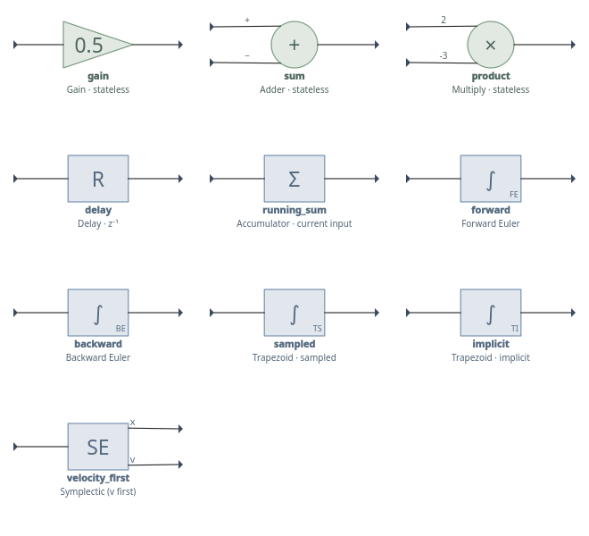
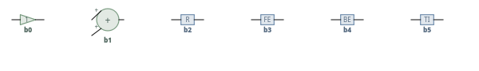

# Basic block symbols

Studio uses mathematical block symbols for basic elements, following the
gain, summing-junction, delay and accumulator conventions in the MIT material.
The [reference record](INTEGRATOR_REFERENCES.md) identifies the sources:
MIT notes §3.2, printed pp. 35–39, and Siebert §7.2, especially Figure 7.2-1,
p. 213. These are original S7 drawings of the conventions, not textbook scans.



| Element | Symbol | Reading it |
| --- | --- | --- |
| `Gain` | Triangle pointing right | The coefficient is shown inside. A negative coefficient retains its sign. |
| `Adder` | Circle with `+` | Each input is marked with its actual weight: `+`, `−`, or another coefficient. |
| `Multiply` | Circle with `×` | Product of the scaled inputs. Non-unit scale factors appear on their respective leads. |
| `Delay`, `PreviousValue` | Rectangle with `R` | One-sample delay; `R = z⁻¹`, as in the MIT operator notation. |
| `Accumulator` | Rectangle with `Σ` | Running sum including the current input; no implicit timestep factor. |
| Scalar integrators | Rectangle with `∫` and method code | The code and caption identify the numerical method and trapezoid mode. |
| `SymplecticIntegrator` | Rectangle with `SE`, position and velocity outputs | Two-state, velocity-first update. |

The instance name appears below the symbol; the type/method appears below
the name when space permits. Gain and input-coefficient previews use five
significant digits for binary64 values; `≈` marks rounding. A near-unit weight
is not replaced by an exact `+` or `−`. Long text is elided with `…` to fit.
Complex coefficients use symbolic `K`, `w0`, `w1`, … or `k0`, `k1`, …; the
indices refer to the input ports and parameter arrays, starting at zero.
Full stored parameter values and the defining equation appear on hover;
parameters can be edited in the element's parameter dialog.
An integral sign denotes the operation, not an exact continuous-time solution:
see [the integrator guide](INTEGRATORS.md) for the implemented recurrences.

At minimum size, integrators show a method code in the rectangle so the
distinction survives even when the full caption does not fit: **FE** forward
Euler, **BE** backward Euler, **TI** implicit trapezoid, **TS** supplied-sample
trapezoid, **GL** Gauss–Legendre, **SE** symplectic Euler and **CE** controlled
Euler. S7's velocity-first symplectic update remains explicitly distinguished
from the position-first Leapfrog recurrence in MIT notes §6.3.



## Equations behind the symbols

With input `u[n]`, output `y[n]`, and input index `i`, the arithmetic symbols mean:

```
Gain:         y[n] = K u[n]
Adder:        y[n] = Σᵢ wᵢ uᵢ[n]
Multiply:     y[n] = Πᵢ (kᵢ uᵢ[n])
Delay:        y[n] = u[n−1], n ≥ 1; y[0] = initial_value
Accumulator:  y[n] = y[n−1] + u[n], n ≥ 0; y[−1] = initial_value
```

These equations describe the intended arithmetic. Integer overflow handling,
finite precision and explicit accumulator types remain part of each element's
contract; a saturating arithmetic block is not a linear system at saturation.

### The accumulator indexing matters

Siebert's Figure 7.2-1 defines `y[n+1] = y[n] + u[n]`, whereas S7's existing
`Accumulator` includes `u[n]` in the current output. The two differ by one
sample in their input-to-output relation. With `R = z⁻¹`, their ideal zero-state
transfer functions are `R/(1−R)` and `1/(1−R)`, respectively.

S7 uses the rectangular `Σ` convention but adds **current input** to its
caption and shows its recurrence on hover. An explicit `Delay` after S7's
accumulator produces the former zero-state transfer; startup still requires
consistent initial conditions. The source's initial-condition annotation is
represented by S7's `initial_value` parameter, rather than an additional
signal port.

### Integrator methods are part of the notation

For constant `h`, the ideal zero-state scalar integrator relations are:

| Method | Difference equation | H(R) |
| --- | --- | --- |
| Forward Euler | `y[n+1] = y[n] + h u[n]` | `h R/(1−R)` |
| Backward Euler | `y[n] = y[n−1] + h u[n]` | `h/(1−R)` |
| Trapezoidal rule | `y[n] = y[n−1] + h/2 (u[n−1]+u[n])` | `h (1+R)/(2 (1−R))` |

The integral sign alone cannot distinguish these operators. Studio therefore
includes a method code in the block, even at minimum size. The
[integrator guide](INTEGRATORS.md) supplies the initial-condition terms,
prescribed `y[0]` convention and distinction between sampled inputs and a
coupled implicit endpoint stage. A scalar transfer-function formula is not a
description of the entire coupled numerical stage or of Euler substeps.

The symplectic block's position and velocity outputs are in that order. With
acceleration input `a`, it stages:

```
v[n+1] = v[n] + h a[n]
x[n+1] = x[n] + h v[n+1]
```

Both appear on the following step. The `SE` symbol identifies this two-state
update. This is the velocity-first ordering; MIT's position-first Leapfrog
example is documented separately in the integrator guide. The product circle
and method badges are S7 presentation conventions, rather than claims of a
literal copy from the cited figure.

## Editing the blocks

The symbols fit inside the existing node footprint. Local leads connect each
symbol to its existing grid ports. Loading an old diagram retains its saved
dimensions, port indices, wire anchors and connections. Resizing, selection,
error indication and parameter editing remain available. Selection outlines
the editable footprint and exposes the usual resize handle.

Schema-backed blocks retain their double frame. Other elements and unavailable
plugin types retain the ordinary labelled block presentation. Changing a
symbol does not change feedthrough, state, coefficients or runtime execution.
