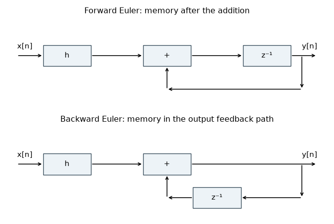
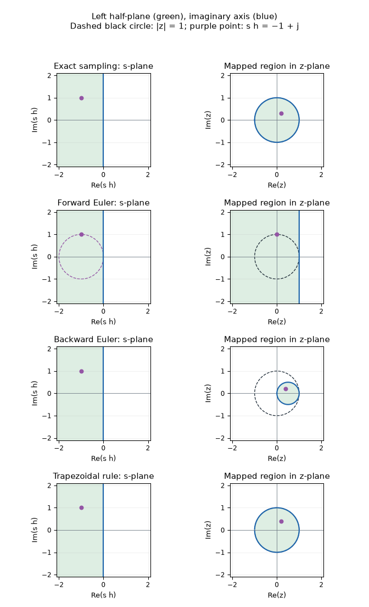
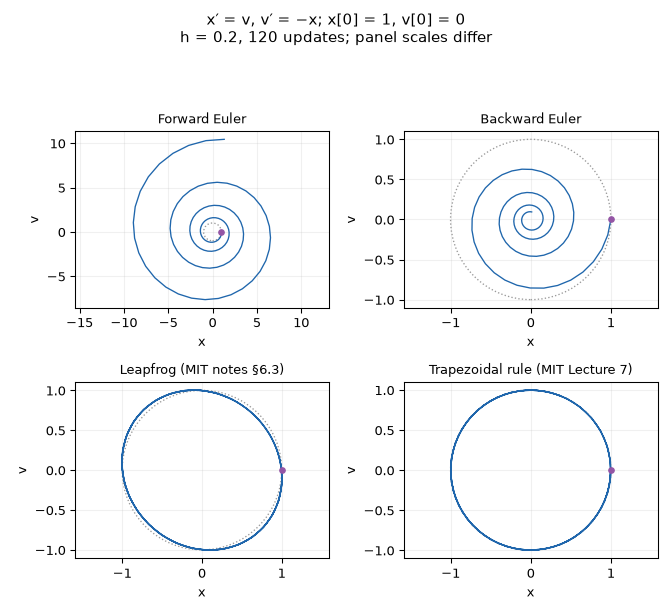

# Integrators, delays, and the s and z planes

S7 models dynamics with explicit interconnected blocks and local state. William
McC. Siebert's *Circuits, Signals, and Systems* inspired this design. This guide
uses the terminology of MIT's signals-and-systems teaching materials and gives
each method's equation so its behavior can be checked independently. The
[reading references](INTEGRATOR_REFERENCES.md) identify editions, pages, diagrams,
and the sections actually reviewed.

## Samples, state, and a one-sample delay

Let `h > 0` be the sample interval in seconds, `x[n]` the supplied derivative,
and `y[n]` the integrated value. A unit delay is `R = z⁻¹`: its output is the
preceding input sample. Delay, gain, and addition are sufficient to realize the
linear recurrences below. A delay is mathematical memory, independent of how
long the computer takes to execute a step.

| Method | Difference equation | Zero-state integrator H(z) |
| --- | --- | --- |
| Forward Euler | `y[n+1] = y[n] + h x[n]` | `h/(z−1)` |
| Backward Euler | `y[n] = y[n−1] + h x[n]`, for `n ≥ 1` | `h z/(z−1)` |
| Trapezoidal rule | `y[n] = y[n−1] + h/2 (x[n−1]+x[n])`, for `n ≥ 1` | `h/2 (z+1)/(z−1)` |

The delay's position matters. Forward Euler places memory after the sum;
backward Euler uses the current derivative and the delayed previous sum.



These are transfer-function realizations. Startup needs initial conditions as
well: prescribing `y[0]` is different from setting a delay's prehistory to zero
when a current-input path exists. See the next section before comparing traces.

## S7 elements and startup

`EulerIntegrator` is displayed as **Forward Euler Integrator**. The existing
serialized type name stays unchanged. `BackwardEulerIntegrator` is a separate
element. Both accept F16–F128 and C16–C128. Their interval follows the resolved
domain rate in diagrams; the C++ constructor can explicitly pin a timestep.

| Element | First successful call | Later behavior | Current-input feedthrough |
| --- | --- | --- | --- |
| Forward Euler (`EulerIntegrator`) | Publishes `initial_value = y[0]`; stages `y[1]` | Publishes the preceding staged update, then stages the next | No |
| `BackwardEulerIntegrator` | Publishes `initial_value = y[0]`, without integrating `x[0]` | Adds `h x[n]` to the previous output | Yes |
| `TrapezoidIntegrator`, `mode="sampled"` | Publishes `y[0]` and records `x[0]` | Adds the endpoint-averaged area | Yes |
| `TrapezoidIntegrator`, `mode="implicit"` | Publishes current state; solves and stages the endpoint | Existing bounded coupled implicit stage | No |

For `h = 1`, `y[0] = 0`, and supplied samples `x = 0, 1, 2, 3`, the published
outputs are forward Euler `0, 0, 1, 3`, backward Euler `0, 1, 3, 6`, and sampled
trapezoid `0, 0.5, 2, 4.5`. The differences follow the endpoint rules.

With the unilateral convention `X(z) = Σ x[n] z⁻ⁿ`, the complete relations,
including the prescribed initial output, are:

```
Forward:   Y = h/(z−1) X + z/(z−1) y[0]
Backward:  Y = h z/(z−1) X + z/(z−1) (y[0] − h x[0])
Trapezoid: Y = h/2 (z+1)/(z−1) X + z/(z−1) (y[0] − h/2 x[0])
```

The latter two correction terms explain why an input impulse at the prescribed
initial sample is not automatically the transfer function's zero-state impulse
experiment. These initial-condition terms are shown explicitly in Siebert,
Problem 8.7. For impulse-response comparisons, apply an impulse after startup
or initialize the internal prehistory consistently with the zero-state experiment.

S7's observation convention remains unchanged: the first successful runtime
step is labelled step 1/time `h`, while causal-memory blocks publish their
initial state on that step. Thus the mathematical index here is `n = step−1`.
An observer timestamp does not silently move a state transition. Backward Euler
and sampled trapezoid update their outputs in the ordinary causal phase.

## Feedback as explicit recurrences

Backward Euler's current-input feedthrough does not make an algebraic cycle
executable. Rearrange a linear feedback equation into a causal delay/gain/adder
realization. This is ordinary graph execution; it needs no graph-wide solver.
For nonlinear feedback, derive a supported local realization explicitly rather
than assuming an arbitrary implicit equation has a unique accessible solution.

For the normalized RC equation `y′ = u − y`, the three discretizations give:

```
Forward:   y[n] = (1−h) y[n−1] + h u[n−1]
Backward:  y[n] = (y[n−1] + h u[n])/(1+h)
Trapezoid: y[n] = ((1−h/2)y[n−1] + h/2(u[n−1]+u[n]))/(1+h/2)
```

Each expression uses only current supplied input, previous input if needed,
and delayed state. A `Delay` stores that state; `Gain` and weighted `Adder`
implement the coefficients. Forward Euler requires `0 < h < 2` for decay in
this normalized example. Backward Euler decays for every positive `h`.
Trapezoid also decays, but alternates sign when `h > 2`: stability does not
make that large-step transient an accurate physical RC response.

Adding a delay to an unreduced backward-Euler derivative loop changes the
equation and its poles. For example, replacing its current `−y[n]` by
`−y[n−1]` gives forward Euler for this RC model. Use the derived coefficients
above to retain the intended method.

For `x′ = v`, `v′ = −x`, write `c = h/2`. Explicit state updates are:

```
Forward:   x_next = x + h v
           v_next = v − h x

Backward:  x_next = (x + h v)/(1+h²)
           v_next = (v − h x)/(1+h²)

Trapezoid: x_next = ((1−c²)x + h v)/(1+c²)
           v_next = (−h x + (1−c²)v)/(1+c²)
```

Two delays publish the old `x,v` together; both additions read those same
values. Reordering the elements must not change the recurrence. Forward Euler
grows the oscillator, backward Euler damps it, and trapezoid preserves
`x²+v²` to numerical roundoff while retaining a phase error.

## Exact sampling and numerical s-to-z maps

A continuous mode `exp(s t)`, with `s = σ + jω`, sampled at `t = n h`, becomes
`zⁿ` with **`z = exp(s h)`**. Therefore `|z| = exp(σ h)` and the discrete
phase increment is `ω h` modulo `2π`. The imaginary axis maps to the unit
circle; stable continuous modes (`σ < 0`) map inside it. This exponential
map is many-to-one in imaginary frequency. It is not the bilinear transform,
and substituting it alone does not define the input/hold model of a sampled system.

For a numerical integrator, substitute its `H(z)` for `1/s`, or equivalently
apply its recurrence to `y′ = s y`. The resulting pole maps are:

| Method | Derivative substitution | Mode/pole map |
| --- | --- | --- |
| Forward Euler | `s ≈ (z−1)/h` | `z = 1 + h s` |
| Backward Euler | `s ≈ (z−1)/(h z)` | `z = 1/(1−h s)` |
| Trapezoidal rule (bilinear/Tustin) | `s ≈ 2/h (z−1)/(z+1)` | `z = (1+h s/2)/(1−h s/2)` |

The maps characterize correctly formed discrete feedback equations. A
standalone integrator's pole remains at `z = 1`; it is not an asymptotically
stable or BIBO-stable block. A simple pole on the unit circle can describe
bounded unforced oscillation, but not BIBO stability under arbitrary forcing.



**Forward Euler.** The whole left half-plane maps to `Re(z) < 1`, which
extends outside the unit circle. Its stable region in the s-plane is only
`|1+h s| < 1`, the disk centered at `−1/h` with radius `1/h`. The imaginary
axis maps to the line `Re(z)=1`: every nonzero undamped oscillatory mode
lies outside the unit circle. A smaller positive step slows the growth but
does not put these poles inside the circle.

**Backward Euler.** The imaginary axis maps to `|z−1/2|=1/2`; the left
half-plane maps inside that smaller circle. The origin maps to `1`, and
infinite imaginary frequency approaches `0`. All stable continuous linear
modes map inside the unit circle (A-stability), and very fast decaying modes
are strongly suppressed (L-stability). Backward Euler can also map some
unstable continuous modes inside the unit circle, so stability preservation
is not an equivalence in both directions.

**Trapezoidal rule.** The imaginary axis maps onto the unit circle except
the limiting point `−1`; the left half-plane maps inside and the right
half-plane outside. For `s=jω`, the discrete phase is
`Ω = 2 atan(ω h/2)`, or `ω = (2/h) tan(Ω/2)` in the principal interval.
This is frequency warping: unit magnitude does not imply exact frequency.
Very fast decaying real modes approach `z=−1`, rather than `0`, so the method
is A-stable but not L-stable. The map has a pole at `s=2/h`.

Vertical s-plane lines map to circles under exact sampling; horizontal lines
map to rays. For the rational maps, circles and straight lines map into circles
or straight lines, including their limiting point at infinity. In particular,
`Re(s h/2)=a` maps under trapezoid to a circle of real center `a/(1−a)`
and radius `1/|1−a|` when `a ≠ 1`; the exceptional case is a straight line.
These geometric statements provide additional checks on a plotted mapping.

## Leapfrog in the MIT notes

MIT's supplementary notes §6.3 use **Leapfrog**, also described there as a
trapezoidal approximation, for this mixed forward/backward update:

```
x_next = x + h v
v_next = v − h x_next
```

Keep that MIT name and update order when reproducing the example. Its
position recurrence is `x[n+2] − (2−h²)x[n+1] + x[n] = 0`.
The poles lie on the unit circle for `0 < h < 2`; at `h=2` the repeated
pole can give growing solutions, and above it the scheme is unstable.
The invariant is `x²+v²+h x v`, not the exact physical quadratic `x²+v²`.
Its numerical phase is `2 asin(h/2)` in this interval.

S7's existing `SymplecticIntegrator` uses the other ordering: update velocity
first, then position. Its oscillator invariant is `x²+v²−h x v`, with the
same stable-step interval. The sign and ordering matter. MIT Lecture 7's
**Trapezoidal rule** instead uses both endpoint averages and yields the
bilinear map above. Cite the recurrence/source when distinguishing them.



## Trapezoid implementation and qualification

Sampled mode is a local quadrature operation. Its first call records the
input without integrating. The existing implicit mode is a separate numerical
stage with held external inputs and at most 64 fixed-point corrections. An
implicit equation can have a valid stable solution even when that iteration
does not converge. For example, `y′=−y` at `h=3` has the trapezoid pole
`−0.2`, but the fixed-point factor is `−1.5`. The explicit RC realization
above works at that step; the existing implicit iteration reports failure.
This solver limitation is not removed by relabeling it as A-stable.

The implementation review fixed premature convergence for small signals:
the old threshold `8 epsilon (1+|candidate|)` introduced a unit-sized absolute
floor. Each native real component's threshold now scales with its current,
base and candidate magnitudes,
with a one-subnormal-quantum rounding floor. Native F128/component precision
is retained. Finite complex components are checked without forming a potentially
overflowing vector norm. It also avoids raising an intermediate overflow for
a finite endpoint area just because the unscaled endpoint sum would overflow.
Invalid initial states, invalid timesteps,
and nonfinite local integration results now fail explicitly. Symplectic updates
validate both new components before publishing either of them.

`s7core_integrators_smoke` checks typed supplied-sample quadrature, startup,
registry/rate behavior, algebraic-loop rejection, explicit RC and oscillator
realizations, modal solutions and ordering independence. `s7core_trapezoid_smoke`
checks small/large signal scaling, all floating/complex types, independent
discrete roots, refinement, energy and failure/retry. Continuous-model accuracy,
discrete-method correctness, floating-point error and solver convergence are
separate questions; successful execution answers none of them by itself.

Figures are original calculations generated by `tools/plot_integrator_help.py`.
They do not embed textbook scans. Sources and reading status:
[Integrator references](INTEGRATOR_REFERENCES.md). Further implementation detail:
[Trapezoid integration](TRAPEZOID_INTEGRATION.md).
