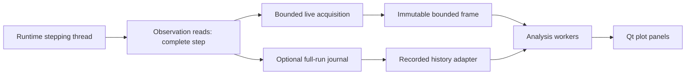

# Live oscilloscope design

Status: target implementation contract, 2026-10-22. The first time-domain
[prototype](LIVE_OSCILLOSCOPE_PROTOTYPE.md) implements a bounded subset; the full
analysis scope and acceptance targets below remain unfulfilled.

The live oscilloscope is a separate, bounded observation instrument for continuous
and finite S7 runs. Its completed feature set must meet the documented analysis
capabilities of Analog Devices IIO Oscilloscope (OSC), and improve inspection
through linked views, precise sample readouts and explicit retention semantics.
Incremental delivery does not reduce that completion criterion.

## 1. Scope and existing foundation

S7 is a causal graph runtime. Observation reads outputs on the stepping thread;
analysis and display never step the graph or change its causal ordering. Time
axes and sample rates derive from model steps and rational model rate, never
wall-clock rendering cadence. No global simulation solver is introduced.

Existing implementation:

- `LocalSchemaRunner::emitScopeSamples()` reads selected outputs and appends
  each to `ObservationSource` before preview publication.
- `ObservationSource` is a run-owned journal with bounded memory and growing
  temporary disk storage. It is suitable for full-run recording, not indefinite
  bounded acquisition.
- Scope supplies time plots, history, comparisons, result save/open and CSV.
  Phase Portrait supplies same-step XY lines; 3D Phase Trajectory is independent.
- Viewer bindings, run identities, Qt Graphs rendering and source-backed exports
  provide reusable contracts. The current viewer replay cursor assumes an
  append-only journal; it cannot silently be reused for an evicting ring.
- Observation currently stores real scalars as binary64 with source-type metadata;
  complex probes are rejected. Wider values can round during conversion.

Keep the existing recording Scope and its explicit result workflow. Add a
`LiveOscilloscope` observer/workspace. Existing Phase Portrait and 3D viewers
remain supported. Runtime elements and the headless observation API remain
independent of Qt. Remote acquisition, direct hardware control, protocol decoding,
complex-valued capture and new runtime frame ports are outside this design.
Two real channels provide I/Q analysis without complex runtime ports.

## 2. Functional benchmark

The [ADI OSC user guide](https://analogdevicesinc.github.io/system-level/software/iio-oscilloscope/)
(accessed 2026-10-22) documents time, frequency, constellation and cross-correlation
views; channel selection; sample count; FFT size/window/averaging/power offset;
lines/dots; markers; capture controls; zoom/autoscale; and data saving.
These are the reference capabilities, not an assertion that S7 implements them.

| Area | Required S7 behavior |
|---|---|
| Acquisition | Adjustable retained window, explicit sample/memory limits, rolling and triggered windows, freeze without stopping simulation |
| Time | Multiple channels, overlay or lanes, visibility/color/scale/offset, model-time axis, lines/dots, grid, autoscale, zoom/pan |
| Spectrum | FFT length, window, averaging, amplitude/power/PSD, reference-aware dB, display offset, peak/fixed markers, peak hold |
| XY / constellation | Explicit X/Y or I/Q bindings, lines/dots, equal aspect, bounded persistence and density |
| Correlation | Auto/cross-correlation, A/B bindings, lag range, normalization, peak-delay marker |
| Inspection | Raw-sample hover readout, paired cursors, selected-region measurements, linked sample interval |
| Workspace | Multiple panels/windows, hideable settings, fullscreen, saved settings, raw/derived export |

Hardware configuration plugins are not a parity requirement for a local causal
graph instrument. Hardware throughput is not implied by UI parity. Qualification
requires the feature matrix and measured operating profiles below.

## 3. User workflow and layout

Run Configuration exposes **Finite duration** and **Continuous** explicitly;
`-1` remains an execution representation, not required user knowledge.
Before starting, show which probes use bounded live acquisition and which use
full recording. A recording Scope requests recording explicitly through its
observer configuration; opening or closing a window never changes that choice.
For an endless run with recording selected, show that retained disk history grows.

A workspace has a channel/settings sidebar, a compact common toolbar, one or
more analysis panels and a status/readout area. Plot type is selectable per panel.
Channel selectors use stable identities and display source path and supplied unit.
Color is consistent across panels but is never the sole identifier.

Common toolbar: **Follow latest**, **Freeze display / Resume live**, **Fit**,
**Acquisition settings**, trigger status, and **Save window**. Simulation
Pause/Resume remains in Studio's run controls and is named separately.

Settings have Acquisition, Channels, Analysis, Trigger and Display sections.
Only the selected analysis's controls are shown. Advanced settings are collapsible.
A linked group uses one immutable acquisition frame and one selected subinterval.
Unlinked panels say so. If a calculation is pending, keep the preceding result
with its frame identity and a visible updating label; never present mixed frames
as synchronized. Dragging the plot into history disables following; Resume live
returns to the newest window. Fit changes axes, not acquisition capacity.

Keyboard navigation supports focusable controls, plot zoom/pan, fit and cursor
movement. Tooltips explain units, normalization, averaging and retention. Layout
must work at 1280×720 and 200% scaling without clipped essential controls.

## 4. Acquisition settings and retention

**The user controls acquisition window length in the live oscilloscope settings,
including while the simulation is running.** Retention and visible plot span are
separate controls: zooming cannot silently allocate more history.

| Setting | Contract |
|---|---|
| Retain last | Positive model-time duration, accepting SI prefixes; also editable as samples per channel |
| Sample count | One canonical integer capacity derived from the chosen duration and effective rate; duration/sample controls update together |
| Visible span | Full retained window or a smaller interval; toolbar may offer time/div with ten horizontal divisions |
| Resource summary | Requested/effective duration, intervals, samples/channel, channels, raw bytes and total budget estimate |
| Recording | Off by default for live-only observers; full-run recording is a separate pre-run subscription |

For rate `Fs` and requested duration `T`, retain `C = ceil(T Fs) + 1`
sample positions, so the possible first-to-last span is at least `T`.
Compute using canonical decimal/rational arithmetic, with checked overflow.
Editing capacity instead gives span `(C-1)/Fs`. Require at least two positions.
Show actual available span separately during initial fill and after a growth.
The plot may clip to the requested duration; no synthetic endpoint is invented.

Proposed initial limits: 8 channels per workspace, 1,000,000 sample positions per
channel, 64 MiB raw acquisition budget per session, and 256 MiB total instrument
allocation budget (rings, snapshots, analysis scratch/results, density grids and
render buffers). These are starting qualification limits, not measured capacity.
Account for real allocated representation and all simultaneously active views.
Reject settings that exceed the budget with an explanation and feasible values;
never silently shorten a requested window. Aggregate admission also applies to
multiple workspaces. Unlimited saved snapshots/comparisons are not allowed in RAM.

Retention is full resolution at the observed model rate. No implicit acquisition
decimation. Optional future reduced-rate capture would need its own anti-alias
filter and rate contract. Rendering reduction is separate and does not change data.

### Settings during a run

Changes are validated as a complete configuration and assigned a generation.
Allocate/reserve resources away from the stepping thread, then apply at a complete
step boundary and acknowledge the effective generation. Failed allocation leaves
the previous configuration active. Do not block a model step on a large resize or
copy: prepare/copy bounded chunks with an explicit handover protocol and catch-up
budget; reject/retry a resize if continuity cannot be preserved within that budget.
The implementation must demonstrate this protocol before enabling online resize.

Shrinking evicts oldest complete steps. Growing preserves existing samples and
fills forward; evicted history cannot be recovered. Pending settings are visible.
All channels switch atomically. Resize resets trigger arming and analysis averages
but preserves a frozen snapshot. A requested size must fit alongside that snapshot.
Changing visible span, color or scale does not reset acquisition or averaging.

Probe identities/types/rate remain frozen per run. Users may select among already
acquired channels during a run. Adding a new probe requires a new run in the first
implementation; hiding a trace does not unsubscribe it.

## 5. Acquisition architecture and ownership

Proposed components in `s7studio/src/observation/`:

- `CapturePlan`: immutable per-run union of probes and live/recording subscriptions.
  Deduplicate physical reads; do not journal live-only channels. A probe shared
  by live and recording subscriptions is read once and routed to both sinks.
- `LiveAcquisition`: session-owned fixed-capacity storage of complete step frames,
  with run/channel identity, step, rational rate metadata, validity and monotonic
  sequence. There is no spill file. Ordinary oldest-frame eviction is retention,
  not capture failure. An internal missed step is a gap with explicit accounting.
- `AcquisitionController`: settings admission, generation handover, rolling/
  triggered acquisition state and bounded snapshot requests. It cannot mutate
  the runtime. Small control requests are handled at step boundaries.
- `AcquisitionFrame`: immutable selected samples plus provenance, coverage,
  acquisition generation and optional trigger identity. Raw values are retained
  for hover, measurements and export. Frames use budgeted ownership; workers
  cannot pin an unbounded chain of obsolete blocks.
- `AnalysisService`: QtCore-only computations over immutable frames. No QWidget,
  runtime element or plugin-loader dependency. Renderer consumes immutable results.

Session ownership survives window close/reopen. Closing a workspace window
releases its display caches and cancels its analysis jobs; configured live
acquisition continues bounded. An explicit session action can release inactive
instruments at a step boundary. Reopening shows the currently retained interval,
not a reconstruction of evicted history. Reset/new run clears live history,
partial channel frames, triggers and averages; old results cannot enter the new run.

Do not change `ObservationSource` into a ring behind its existing API. Introduce
an explicit bounded-source contract with oldest/newest sequence, generation,
coverage and range requests. Snapshot extraction must have bounded producer lock
hold times: use fixed-size blocks and bounded copies/ownership, with a documented
reservation scheme for spare blocks and snapshots. Never hold an acquisition
mutex during FFT, rendering, export, file dialogs or an entire history scan.

With only live subscriptions, do not create a temporary journal at all. Existing
recording Scopes continue using `ObservationSource` and existing completeness/error
semantics. Recording write failure fails the run as today. Live analysis failure
or budget rejection reports an instrument error without terminating simulation;
if live data is lost, record the exact affected coverage and never imply continuity.
Observation can cost wall-clock throughput, but cannot change step/model-time semantics.

## 6. State, freeze and triggers

Display state and acquisition state are separate:

- **Following** shows the latest admitted frame at a bounded refresh cadence.
- **History** browses retained history; live retention still advances.
- **Frozen** owns a bounded immutable snapshot. It survives ring wrap/resize and
  remains the source for hover/export until Resume live or explicit release.
- Trigger state is **Rolling**, **Armed**, **Collecting post-trigger**,
  **Held single capture**, or **Error**. Run state is displayed independently.

Freeze is asynchronous and acknowledged with exact first/last step. During the
request show Freezing; never claim the screen is frozen before its data is pinned.
If a browsed interval expires before pinning, report expiration rather than
substitute new samples. A frozen result can be saved after the run ends.

Required triggering: Auto, Normal and Single edge acquisition; rising/falling,
source, threshold in source units, hysteresis, pre-trigger percentage, and holdoff.
Define rising edge as arming at/below `level-hysteresis/2` and firing at/above
`level+hysteresis/2`; falling is symmetric. Zero hysteresis requires a genuine
previous-to-current crossing, not repeated equal samples. Store the firing sample
step; any interpolated crossing estimate is supplementary and labeled.

Trigger detection operates on full-rate samples on the acquisition producer,
with constant bounded work per step; GUI polling cannot detect triggers reliably.
For C positions and pre-trigger fraction p, reserve `floor(p*(C-1))` positions
before the trigger, one trigger position, and the remainder after it. Arm only
when the prehistory requirement is satisfied. A gap resets arming. Thresholds
and holdoff are evaluated in model steps/time. Triggered display time zero is
relative to the firing step; absolute model time remains available.

Normal waits without fabricating a capture. Single holds one completed snapshot
until Rearm, while the live ring continues. Auto emits an explicitly untriggered
window after a configurable model-time timeout. Stop before post-trigger completion
preserves a labeled partial capture. Rearm/holdoff begins after the capture end;
triggers during collection/holdoff are deliberately ignored. Bound retained trigger
history to one completed frame initially; no automatic disk saving.

## 7. Exact cursor and measurements

**Moving the mouse over a plot displays the actual underlying value**, not a value
read back from pixels or a rounded axis label. Show a crosshair and stable readout
with channel, unit, model time, step/sample index and value. For aligned time
channels, choose the nearest sample in model time, breaking ties toward the earlier
step, and show all selected channels at that step. Missing values say unavailable.

The readout queries raw samples in the displayed frame even when the curve is an
envelope. For following mode, hover pins that bounded displayed frame until the
pointer leaves or the user resumes updates; indicate Inspecting frame and its age.
Never let the readout and visible trace refer to different acquisitions. Persistent
cursors A/B use the same binding, with delta time/value and `1/Δt` when nonzero.
Allow sample-by-sample keyboard movement and copy readout to clipboard.

Default value text uses shortest round-trip binary64 formatting; expanded details
can show 17 significant digits, raw source type and stored binary64 representation.
Exact means exact stored sample: it does not restore precision lost by a wider
source conversion. SI formatting must offer an unscaled copy. Interpolated values
are optional, explicitly labeled, and never replace snapped samples by default.

For XY, hit-test points in screen space, then show the selected pair's raw X/Y,
step and time; ties use nearest screen distance then newest step. Dense regions
allow cycling candidates. For spectrum, show bin index, exact bin-center frequency,
computed magnitude and normalization; an interpolated peak is labeled an estimate.
For correlation, show integer lag, lag time, computed correlation and normalization.
Density pixels are aggregate counts, not individual sample values; hovering shows
bin bounds/count and can switch to raw-point inspection.

Region measurements use raw samples within inclusive step endpoints: count,
min/max with positions, mean, RMS, peak-to-peak and standard deviation (population,
divisor N). Display offset/scale/color never changes measured values. Use stable
summation and handle overflow explicitly. Frequency/period and rise/fall estimates
require documented crossing thresholds, sufficient events and labeled confidence;
otherwise report unavailable. Do not silently discard NaN/Inf: mark affected
coverage; line segments break and analyses requiring finite inputs reject it.

## 8. Numerical analysis contracts

All analysis is binary64 initially. Inputs must belong to one run and coherent
step interval. Align pairs by run and step, never arrival order or nearest floating
timestamp. Require consecutive steps at a single known rate for FFT/correlation;
no zero filling gaps or implicit resampling. Irregular/imported inputs may still
be plotted in time, but unsupported analyses explain why they are unavailable.

### Spectrum

Use `N` contiguous raw positions at rate `Fs`; bin spacing is `Fs/N`.
Default N=4096, periodic Hann window, no detrending, 50% overlap for rolling
averages. Offer rectangular, periodic Hann, Hamming, Blackman and four-term
Blackman-Harris with explicit coefficients in implementation/tests. Initially
support powers of two from 64 through 65536, subject to frame/budget limits.
A larger FFT than available data reports Filling, not zero-padded false resolution.

Define unnormalized DFT `X[k] = sum_n w[n] x[n] exp(-i 2πkn/N)`,
`S1=sum w[n]`, `S2=sum w[n]^2`. For real inputs:

- One-sided peak amplitude is `|X[k]|/S1`, doubled except DC and Nyquist.
- One-sided mean-square power per bin is `|X[k]|²/(N*S2)`, doubled except
  DC/Nyquist; summed bins equal the window-weighted mean square.
- One-sided PSD is `|X[k]|²/(Fs*S2)`, with the same endpoint rules.
- ENBW is `Fs*S2/S1²`. Tone amplitude and integrated noise power are different
  quantities; a power display must not square the coherent-gain amplitude and
  present it as window-independent noise power.

I/Q spectrum forms `z=I+iQ`, uses two-sided shifted bins with no doubling and
explicit complex amplitude/PSD labels. It requires compatible supplied units
or an explicit unit declaration; never infer compatibility from channel names.
Optional mean removal is visible in settings and result metadata. No hidden DC
removal or calibration. Frequency is baseband by default; an explicit frequency
axis offset is presentation metadata, not a changed sample rate.

Linear units are U (amplitude), U² (power), U²/Hz (PSD). dB uses
`20 log10(A/Aref)` or `10 log10(P/Pref)` with displayed reference and units.
No default claim of dBFS without an explicit full-scale convention; no dBm
without a defined physical conversion. Zero is -infinity; a display floor is
labeled and raw exports preserve the result. User dB offset is visibly applied.

Finite averaging uses K complete spectra; exponential averaging uses explicit
alpha, `Pavg=(1-alpha)*Pavg+alpha*P`, initialized from the first frame.
Average linear power/PSD before converting to dB; amplitude averaging, if offered,
has its own label. Count each hop once regardless of GUI refresh. Reset averages
and peak hold on input, window, N, rate, normalization or acquisition-generation
change, gaps and rerun. Changing only axis limits does not reset them. Bound K.
Peak/fixed markers report bins; optional quadratic peak interpolation reports an
estimate with method metadata. Single-tone fundamental/harmonic/image markers
require explicit tone selection and frequency folding rules, not guessed labels.

### XY / constellation

The existing phase portrait's same-step alignment is reusable. Provide trajectory
lines, raw dots, equal-axis scaling, newest-point marker, bounded persistence by
model duration/frame count, and a fixed-size saturating density grid. Lines never
bridge gaps. Persistence eviction and density decay use model time, not repaint
count. Density records are distinct from raw sample storage and have a hard budget.
Constellation is an I/Q preset; no implicit carrier recovery, symbol timing,
equalization, EVM or communications-quality claims. General X/Y axes may have
different units; equal aspect then means equal numeric scale and is user-selected.

### Correlation

For real equal-length arrays A and B, define
`r_AB[l] = sum_n A[n] B[n+l]` over valid overlap, `-(N-1) <= l <= N-1`.
Thus positive lag means B occurs later than A; show that convention beside A/B.
A delayed impulse must demonstrate the sign in both the test and UI example.
Offer raw sum, biased (`/N`), unbiased (`/(N-|l|)`) and coefficient
(`r/sqrt(sum A² * sum B²)`, full-window energies). Mean removal is an explicit
setting. Coefficient normalization with zero energy is undefined and displayed
as unavailable. Raw units are UA·UB; coefficient is dimensionless. Auto-correlation
uses A=B. Limit requested lag, show overlap count, and avoid interpreting low-overlap
edge peaks as reliable delay. Peak selection supports positive peak or absolute
magnitude, with deterministic smallest-absolute-lag tie breaking, then negative lag.

Use linear FFT correlation padded to at least `2N-1`, with tested indexing/scaling;
never substitute circular correlation. Verify against a direct O(N²) reference
for small arrays. Integer peak lag is authoritative; sub-sample interpolation is
optional and labeled estimated. Pairwise complex correlation is deferred until
complex observation has its own contract.

### Backend boundary

Add a private Studio analysis library; do not link Studio to the out-of-tree
`s7spectral` runtime plugin or register special analysis elements in the graph.
Prefer a double-precision FFT backend behind a small adapter. Backend selection
and packaging are implementation prerequisites: confirm supported Linux/Windows
availability, notices and licensing, and benchmark against the target envelope.
The adapter exposes transform scaling so numerical tests are backend-independent.
No backend choice may pull Qt into the headless runtime or move `s7spectral` into
the main build. DSP formulas must be reviewed independently of existing plugin
single-precision normalization helpers.

## 9. Rendering, scheduling and resource behavior

Start with existing Qt Graphs/Widgets integration. Time traces use per-pixel
min/max envelopes retaining extrema and chronological order; raw points appear
when zoomed in. Do not draw across gaps. Uniform every-Nth thinning is unsuitable
for spike inspection and must not feed measurements or DSP. Spectrum reduction
preserves peaks; XY uses bounded dots/density rather than time envelopes.

Target display refresh is 30 Hz, user-selectable 10–60 Hz. Acquisition and trigger
detection are independent of this cadence. One active job plus one replaceable
latest request per analysis panel; a bounded shared worker pool, not a thread
per frame. Jobs carry run ID, configuration generation, frame ID and panel revision.
Discard stale completions. Cancellation is cooperative at bounded processing
boundaries. FFT scratch/plans, averaging arrays and queued requests are budgeted.

If workers cannot process every analysis hop, do not pretend an average includes
all windows. Bound analysis backlog, count skipped hops and reset/mark discontinuous
averaging when continuity is required. The scope may skip refreshes without losing
raw samples inside the ring. Show separately: ordinary history eviction, missed
capture steps, skipped display updates, skipped analysis frames and recording errors.

Export pins one admitted immutable interval and runs asynchronously with progress
and cancellation; atomic destination replacement preserves an existing file on
failure. Export never races an evicting cursor. Large recorded-history analysis
uses bounded asynchronous paging. UI callbacks only install bounded ready results.
If Qt Graphs cannot meet measured rendering targets, change the Studio renderer
behind the same data contract; do not reduce numerical fidelity to hide the issue.

## 10. Persistence and lifecycle

**Save window** saves the exact raw acquisition frame, run/model provenance,
channel identities/units/source and stored types, rational sample rate, inclusive
step range, gaps, acquisition settings and trigger metadata. Reuse existing
`.s7scope` encoding where semantically valid; introduce a documented version or
separate container if required, with no compatibility shim obligation pre-MVP.
Do not mislabel a bounded window as the complete run. CSV offers raw samples or
explicitly derived data; derived files include formulas/settings, frame identity,
normalization, averaging coverage and units. Image export identifies the interval
and analysis settings. MAT export is optional, not a dependency of completion.

Workspace settings persist with the diagram: panel layout/bindings, retention,
view/trigger/analysis parameters, units/references and channel styles. Validate
on load; workspace files do not silently embed raw samples or arm recording.
An explicit export/save owns portable data; live rings are not crash-durable.

Simulation pause leaves the latest frame inspectable; resume continues without a
wall-clock gap in model steps. Stop seals currently retained data and partial
trigger status. New run clears run-specific state and never automatically retains
unbounded prior live runs. Closing/hiding does not pause simulation or start/stop
recording. Document replacement and shutdown invalidate generations, cancel jobs,
join workers and release sources in a defined order before GUI/plugin teardown.

## 11. Verification and acceptance

Every stage adds meaningful QtCore/data tests and focused rendered interaction
tests. Existing full recording, lifecycle, numerical and headless checks stay green.
Tests use temporary directories, never HOME, and fixtures are causal element
networks or synthetic observation inputs; independent numerical references belong
only in tests. Numerical tolerances are explicit per fixture before implementation
is accepted; screenshot similarity alone establishes no analytical correctness.

| Gate | Required evidence |
|---|---|
| Bounded storage | Many wraps across channels/workspaces; allocated caps enforced including pinned frames/jobs; zero live-only journal files; stable RSS after warmup; explicit recording still complete |
| Settings | Duration/sample round trips at rational rates; overflow/budget rejection; atomic grow/shrink under load; failed resize rollback; freeze survives shrink; growth shows filling |
| Identity | Same-step pairs, run isolation, stale-job rejection, wrap/resize/close/reopen, stop/reset/rerun and shutdown with workers active |
| Cursor | Exact stored sample readout at multiple zoom levels and reduced envelopes; earliest tie; raw extrema; gaps; freeze identity; XY hit test; FFT bins and lag readout; clipboard round trip |
| Time | Narrow single-step spikes survive display reduction; mixed-unit lanes; no lines across gaps; raw-region statistics against independent reference |
| Trigger | Rising/falling/hysteresis, equality/plateaus, prehistory, auto timeout, single/rearm, holdoff, wrap, resize, gap and stopped partial post-trigger |
| Spectrum | DC, Nyquist, coherent/off-bin sine, two tones, noise, I/Q sign, Parseval power/PSD integration, window gain/ENBW, averages/peak hold and explicit dB references |
| Correlation | Impulses with signed delays, identical/unrelated inputs, unequal units, mean removal, zero energy, overlap edges; FFT equals direct reference |
| XY | Same-step I/Q circle and known point clusters; lines/dots, aspect, density counts/saturation, deterministic persistence expiry and gap handling |
| Export | Saved frame equals displayed raw interval despite concurrent wraps; reload and metadata fidelity; cancellation/write failure preserves destination |
| Usability | Actual pixels, hover/cursors, keyboard, fullscreen/settings, linked frame identity, high DPI, dark/light palettes and distinct status meanings |

Proposed qualification workload: 8 channels at 100 ksample/s/channel in model
time; 1 s retained, time/spectrum/XY/correlation panels, N=4096 FFT and N=4096
correlation, 30 Hz display. Record achieved model-step throughput separately from
rendering cadence: this is not a promise that every graph sustains real-time pace.
Measure acquisition-only overhead against the identical graph with the instrument
disabled. Include a 1 kHz slow simulation and an unthrottled producer overload case.

Targets on a named reference Linux desktop: p95 local input-to-feedback <=100 ms,
p95 latest-frame age <=200 ms under paced load, acquisition mutex hold <=1 ms,
no growing job queue, no acquisition disk growth, and total instrument allocation
within the admitted budget. Run at least 30 minutes after warmup and report RSS,
CPU, frame/hop skips and maxima as well as percentiles. Automated accelerated
wrap tests do not replace the soak. These are proposed acceptance targets, not
results; revise only with documented measurements and rationale.

Linux installed-package acceptance is required for the current preview. Native
Windows rendering/performance and high-DPI checks are required before claiming
Windows parity; Wine is useful for regression but not a rendering reference.

## 12. Delivery sequence and completion

1. **Acquisition foundation:** explicit subscription plan; bounded live source;
   online window settings; coherent frames; live-only zero-disk tests; preserve
   existing recording behavior. No new plot can compensate for a growing journal.
2. **Useful live instrument:** registered viewer; rolling/frozen/history display;
   channel controls, extrema-preserving rendering, exact hover, paired cursors,
   statistics, async save window and run lifecycle coverage.
3. **Four-view analysis:** reviewed binary64 FFT adapter; spectrum; XY/constellation
   upgrade; correlation; linked frames, markers, averaging/persistence, exports.
4. **Triggered instrument and workspace:** Auto/Normal/Single, pre/post-trigger,
   holdoff, saved layouts, simultaneous panels and complete help/examples.
5. **Parity qualification:** close every benchmark row, numerical and rendered
   gates, operational soak, installed Linux package and published feature/limit
   report. Record Windows evidence separately.

These are milestones, not permission to call stages 1–2 OSC-equivalent. The
bounded-live release gate in DEVELOPMENT_PLAN remains mandatory; release planning
must explicitly identify which milestones ship. Full OSC parity requires stages
1–5. EVM, eye diagrams, waterfalls, protocol decoding and remote acquisition are
future extensions, not substitutes for finishing the four core views.

Implementation review must settle the FFT backend/packaging, prove the ring
snapshot/online-resize handover against its budgets, and calibrate the proposed
resource/performance envelope. The product decisions are explicit here: user-
controlled retention during a run, raw-sample cursor values, full-rate analysis,
bounded live-only storage and separate opt-in full recording.

Related: [current viewer contracts](STUDIO_OBSERVATION_VIEWERS.md),
[result format](SCOPE_RESULTS.md), [development plan](DEVELOPMENT_PLAN.md),
[simulation semantics](SIMULATION_MODEL.md), [open problems](OPEN_PROBLEMS.md).
