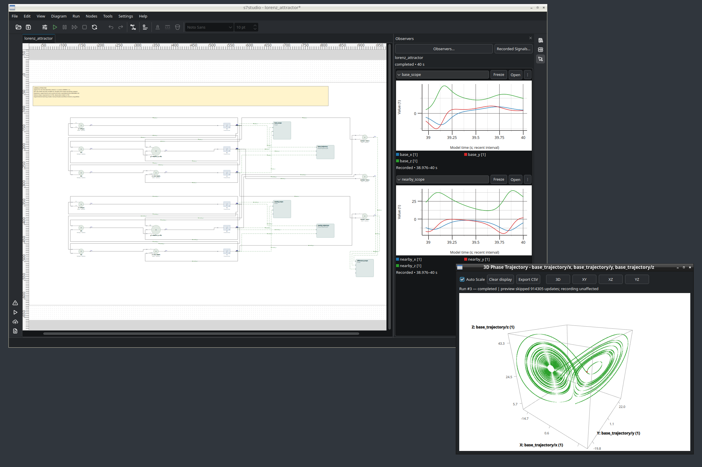
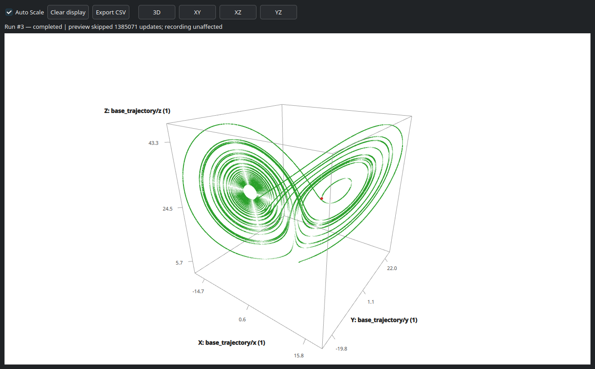
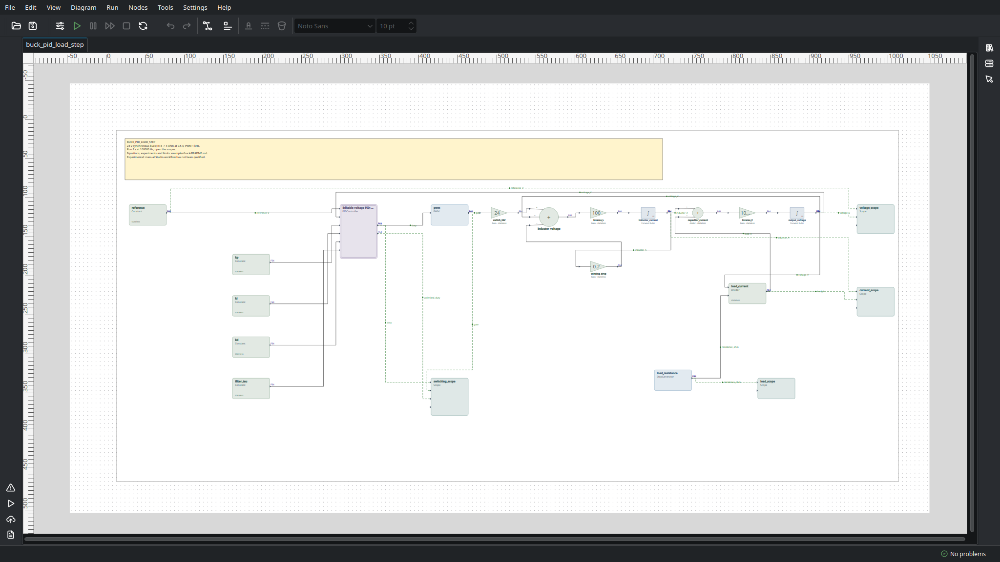
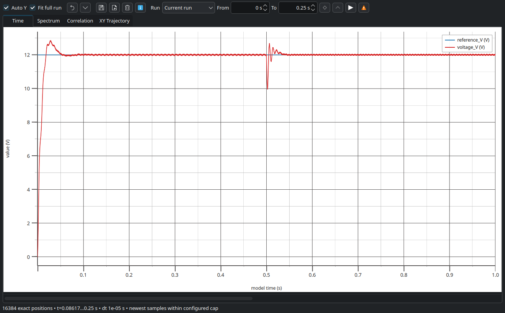
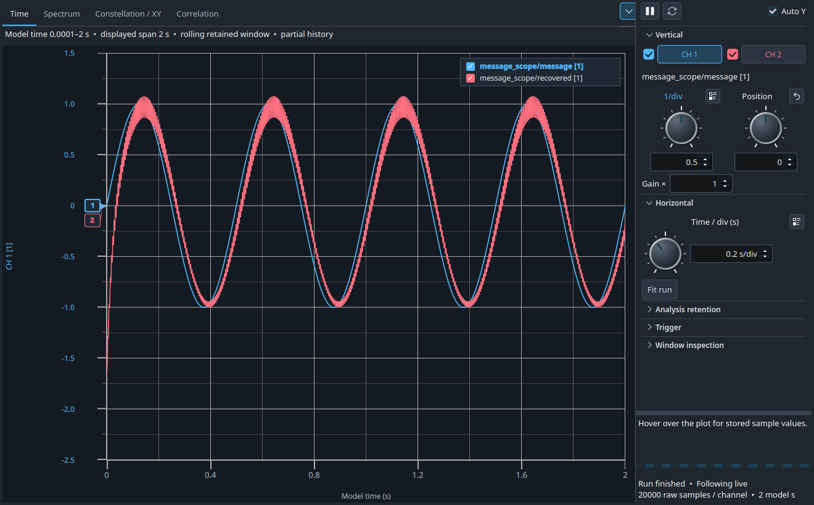
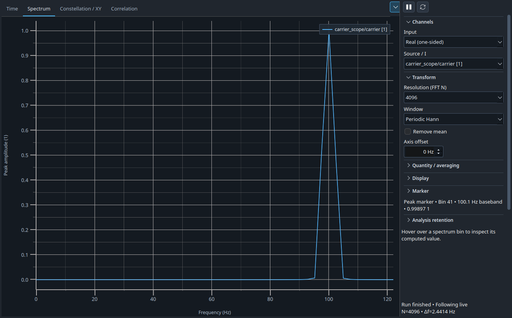
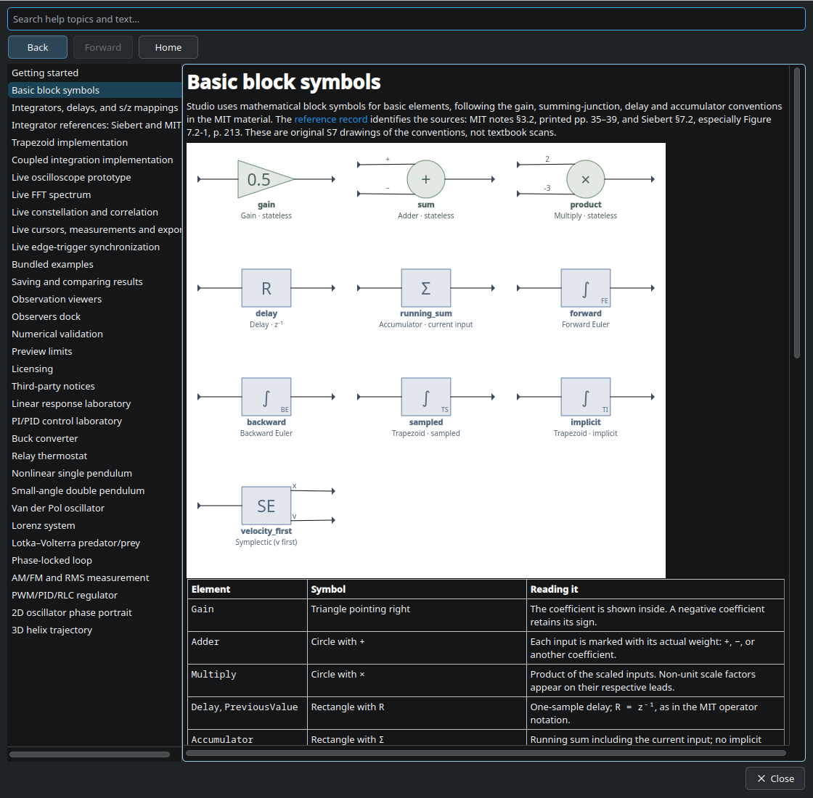

# S7 Studio in action

Seven screenshots from the current S7 source: three bundled examples covering
nonlinear dynamics, feedback control and signal processing, plus the integrated
mathematical help. These are actual Studio windows and runs using its bundled
causal graph runtime; no separate runtime service is needed. The 0.1.2 release
archives are an earlier preview; these captures include the newer block shapes.

To reproduce them, choose **File → Example Diagrams…**, open the named diagram,
and set the duration and rate in **Run Configuration**. Double-click an observer
in the diagram to open its window. **Scope** displays recorded signals;
**Live Oscilloscope** provides bounded live acquisition with Time, Spectrum,
Constellation / XY, and Correlation views. A finished run remains available
for inspection.

## README overview: the Lorenz model and its observers

**Layout provisional, 2026-11-18:** the maintainer requested a later layout
revision. The current image is retained for now; the
[open follow-up](../s7l2/docs/OPEN_PROBLEMS.md#readme-screenshot-layout--follow-up)
records the requested improvements.



The main README shows **one captured Studio desktop**: the diagram viewport
focuses on the `base` network, the **3D Phase Trajectory** displays its butterfly
attractor, and **Scope** shows `base_x`, `base_y` and `base_z` over model time
20–40. The bundled example also computes the nearby-initial-condition network;
the viewport focus does not remove it from the model. The windows were arranged
before capture; the image is not a montage of separate plots.

This is the bundled `lorenz/lorenz_attractor.s7diagram` after a successful
**40-model-second run at 4 kHz**, with sigma=10, rho=28, beta=8/3 and base initial
state (1,1,1). The capture verifies 160,000 trajectory points, three Scope
channels and no source capture loss/storage failure. The observers display the
completed recording. Notices about skipped preview updates concern screen
refresh, not dropped recorded samples. The linked
[model guide](../s7l2/examples/lorenz/README.md) gives the equations, independent
numerical checks and limits; the screenshot illustrates the workflow.

The system comes from Edward N. Lorenz,
[“Deterministic Nonperiodic Flow”](https://journals.ametsoc.org/view/journals/atsc/20/2/1520-0469_1963_020_0130_dnf_2_0_co_2.xml),
*Journal of the Atmospheric Sciences* 20(2), 130–141 (1963).

### Overview capture provenance and reproduction

Captured 2026-11-18 from runtime revision `4cc4ef8` plus the publication-only
layout changes in `s7studio/tests/gui/workflows_test.cpp`. No runtime, numerical
or viewer implementation was changed for the image. It uses a private
2400×1500 Xvfb display, Qt 6.11.2 and Mesa llvmpipe. The dedicated Lorenz row
passed with no failures or skips. Source logs and the original PNG are retained
in `/tmp/s7-lorenz-readme-artifacts3/` and `/tmp/s7-lorenz-readme-captures3/` for
this working session.

From `s7l2/`, reproduce the overview with:

```sh
cmake --build build-release --target s7studio_gui_workflows_test s7studio_gui_capture --parallel 2
S7_README_SCREENSHOTS=1 S7_GUI_EXAMPLES=0/1 \
S7_USABILITY_CAPTURE_DIR=/tmp/s7-lorenz-readme-captures3 \
python3 -B tools/run_gui_test.py --artifacts /tmp/s7-lorenz-readme-artifacts3 \
  --capture build-release/s7studio/s7studio_gui_capture --graphics \
  --screen-size 2400x1500 --timeout 240 \
  -- build-release/s7studio/s7studio_gui_workflows_test \
  bundledExamplesRunAndRender:lorenz/lorenz_attractor.s7diagram
```

Inspect `lorenz-overview.png` before copying it to `07-lorenz-overview.png`.
The publication mode selects the recorded Time view and arranges real windows;
ordinary example tests keep their existing analysis and layout checks.

## 1. Lorenz attractor: a trajectory in three dimensions



The **3D phase trajectory** viewer plots the three coupled states of the Lorenz
system. The trajectory winds around two lobes, and the red marker identifies
the newest point. Drag to rotate, scroll to zoom, or use XY, XZ and YZ for
projections. This capture uses a zoomed perspective view after the run and
recorded-history loading have both completed.

**Try it:** open `lorenz/lorenz_attractor.s7diagram`, run **40 seconds at
4 kHz**, then open `base_trajectory`. The diagram also contains a second
network with a slightly different initial state for exploring sensitivity to
initial conditions. This is an experimental teaching model; its long chaotic
trajectory is not a claim of pointwise numerical accuracy.

[Model, equations and numerical checks](../s7l2/examples/lorenz/README.md).

## 2. Buck converter: the editable control diagram



The diagram describes an ideal 24 V synchronous buck converter regulated
toward **12 V**. PWM, explicit current and voltage integrators, and an editable
PID schema form the feedback loop. Gain triangles, signed summing circles and
integrator method codes identify the basic operations. Observation elements expose voltage,
current, switching and load signals. The model is assembled from connected
elements; double-click the PID instance to inspect its internal graph.

**Try it:** open `buck/buck_pid_load_step.s7diagram` and run **1 second at
100 kHz**. The load resistance changes from **8 Ω to 4 Ω at 0.5 s**.

## 3. Buck converter: the recorded Scope response



The **Scope** window shows the recorded output and reference across the run.
Startup brings the output toward 12 V; the heavier load at 0.5 s causes a dip,
followed by recovery. Zoom into the load transition to inspect regulation, or
into a few switching periods to inspect ripple. Scope retains the recorded
data for later inspection and export.

**Open:** `voltage_scope` in the same buck converter diagram. The example is
an experimental ideal converter model with documented numerical checks, not
a hardware design.

[Converter model, controller and experiments](../s7l2/examples/buck/README.md).

## 4. AM detection: original and recovered messages in Live Scope



The **Live Oscilloscope** Time view compares the original **2 Hz** message
with the recovered message. A coherent detector mixes the AM signal with the
same **100 Hz** carrier used by the transmitter, then applies a low-pass
filter. Startup, a small delay and residual carrier ripple in the recovered
trace show the filter's behavior.

**Try it:** open `signal_measurement/am_coherent_detection_live.s7diagram`,
open `message_scope`, and run **2 seconds at 10,000 Hz**, its bundled rate. For this capture,
**Analysis retention → Raw samples / channel** was set to **32,768 before
starting**. The example uses seven bounded live channels and no full-run
recording channels. The Time view also supports continuous runs and freezing
the display for inspection.

## 5. AM detection: measuring the carrier spectrum



The same example's `carrier_scope` provides frequency analysis in the
**Spectrum** tab. Selecting the pure `carrier` channel shows the **100 Hz**
carrier with **peak amplitude approximately 1**. The **4,096-point periodic Hann window** at
10,000 Hz gives **2.44140625 Hz bin spacing**; its nearest bin to the carrier
is at **100.09765625 Hz**. The carrier is between bins, so the windowed peak
need not equal its ideal amplitude exactly. The plot shows the useful low-frequency range.
This is the unmodulated carrier channel, whose amplitude is dimensionless.

**Open:** `carrier_scope` → **Spectrum**, then choose
`carrier_scope/carrier [1]`. The `am_V` and `envelope_V` channels are also
available in this window for inspecting modulation in the Time view.

[AM detector and related examples](../s7l2/examples/signal_measurement/README.md)
· [Spectrum controls](../s7l2/docs/STUDIO_SPECTRUM.md)
· [All bundled examples](../s7l2/docs/STUDIO_EXAMPLES.md).

## 6. Mathematical help: block notation and equations



Studio's offline help explains the displayed notation, actual recurrences and
initial conditions. The block guide distinguishes S7's current-input accumulator
from Siebert's earlier-input convention and labels each integration method.
The integrator guide covers pole mappings, explicit feedback realizations and
frequency warping, with MIT/Siebert references. Press **F1**, then choose
**Basic block symbols** or **Integrators, delays, and s/z mappings**.

[Integrator guide](../s7l2/docs/INTEGRATORS.md)
· [Block notation and equations](../s7l2/docs/DIAGRAM_SYMBOLS.md).

## Original six captures: provenance and reproduction

Captured on 2026-11-17 from runtime/UI revision `ec6117b` on Fedora 45 with
Qt 6.11.2 and Mesa llvmpipe, using a private virtual display. Capture-only
workflow changes in this update wait for recorded phase history, select the
carrier channel, enlarge windows and set retention/camera framing. The PNGs
come directly from Studio's rendered windows. These examples illustrate
workflows; their linked articles describe the numerical checks and limits.
The capture workflow checks the recorded source for capture loss or storage
failure. Visible notices about skipped preview updates concern screen refresh;
they do not themselves indicate lost recorded samples.

To regenerate the source captures from `s7l2/`:

```sh
cmake --build build-release --target s7studio_gui_workflows_test s7studio_gui_capture --parallel 2
S7_README_SCREENSHOTS=1 S7_GUI_EXAMPLES=0/1 \
S7_USABILITY_CAPTURE_DIR=/tmp/s7-readme-captures \
python3 tools/run_gui_test.py --artifacts /tmp/s7-readme-artifacts \
  --capture build-release/s7studio/s7studio_gui_capture --graphics \
  --screen-size 2400x1500 --timeout 240 \
  -- build-release/s7studio/s7studio_gui_workflows_test \
  bundledExamplesRunAndRender:lorenz/lorenz_attractor.s7diagram \
  bundledExamplesRunAndRender:buck/buck_pid_load_step.s7diagram \
  bundledExamplesRunAndRender:signal_measurement/am_coherent_detection_live.s7diagram \
  helpAndAbout
```

Choose the named viewer captures from that directory; the diagram image is
`buck_buck_pid_load_step-studio.png`, and the help image is
`basic-symbols.png`. Inspect every PNG before replacing the published
files. The test report records run failures, skipped graphics and plot-range
problems; a screenshot alone is not numerical validation.
