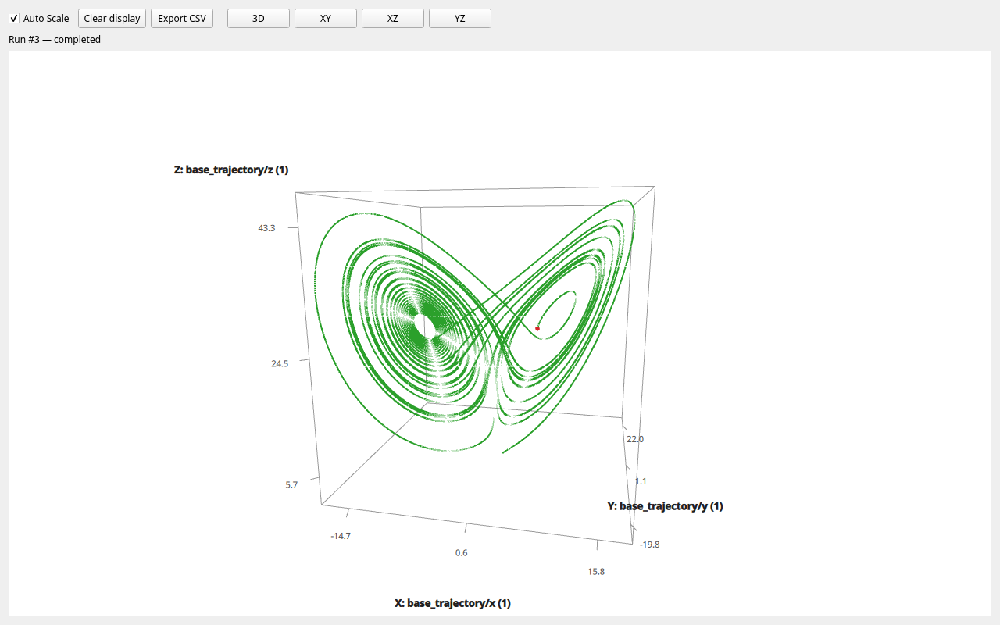
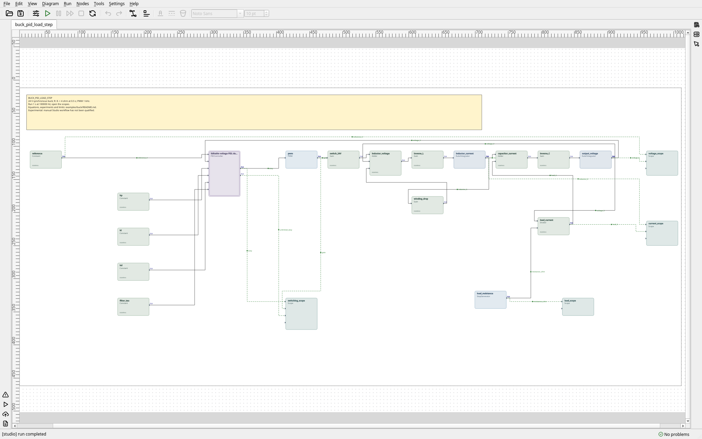
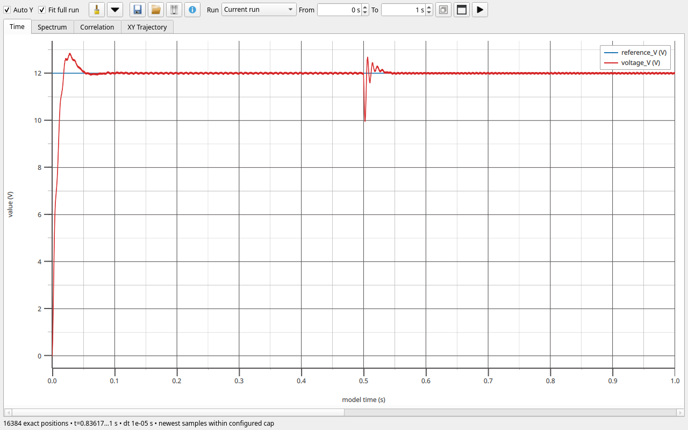
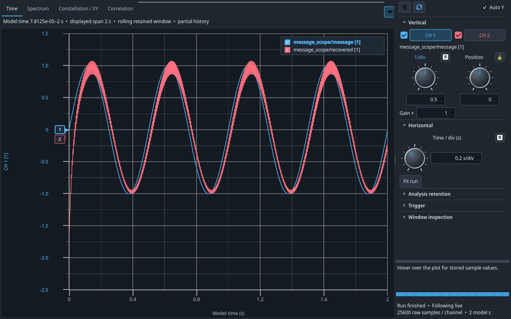
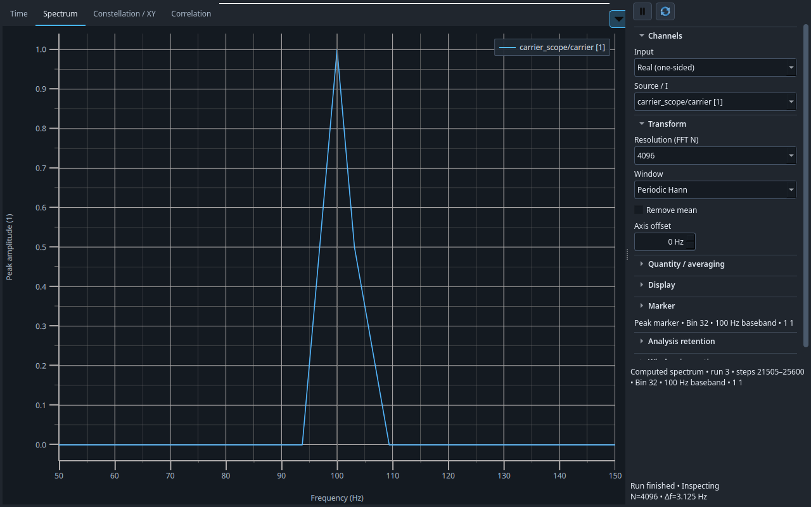

# S7 Studio in action

Five screenshots from three bundled examples in the S7 0.1.2 preview:
nonlinear dynamics, feedback control, and signal processing. These are actual
Studio runs using its bundled causal graph runtime; no separate runtime
service is needed.

To reproduce them, choose **File → Example Diagrams…**, open the named diagram,
and set the duration and rate in **Run Configuration**. Double-click an observer
in the diagram to open its window. **Scope** displays recorded signals;
**Live Oscilloscope** provides bounded live acquisition with Time, Spectrum,
Constellation / XY, and Correlation views. A finished run remains available
for inspection.

## 1. Lorenz attractor: a trajectory in three dimensions

The **3D phase trajectory** viewer plots the three coupled states of the Lorenz
system. The trajectory winds around two lobes, and the red marker identifies
the newest point. Drag to rotate, scroll to zoom, or use XY, XZ and YZ for
projections. This capture uses a rotated, zoomed view after the complete run.

**Try it:** open `lorenz/lorenz_attractor.s7diagram`, run **40 seconds at
4 kHz**, then open `base_trajectory`. The diagram also contains a second
network with a slightly different initial state for exploring sensitivity to
initial conditions. This is an experimental teaching model; its long chaotic
trajectory is not a claim of pointwise numerical accuracy.

[Model, equations and numerical checks](../s7l2/examples/lorenz/README.md).

## 2. Buck converter: the editable control diagram

The diagram describes an ideal 24 V synchronous buck converter regulated
toward **12 V**. PWM, explicit current and voltage integrators, and an editable
PID schema form the feedback loop. Observation elements expose voltage,
current, switching and load signals. The model is assembled from connected
elements; double-click the PID instance to inspect its internal graph.

**Try it:** open `buck/buck_pid_load_step.s7diagram` and run **1 second at
100 kHz**. The load resistance changes from **8 Ω to 4 Ω at 0.5 s**.

## 3. Buck converter: the recorded Scope response

The **Scope** window shows the recorded output and reference across the run.
Startup brings the output toward 12 V; the heavier load at 0.5 s causes a dip,
followed by recovery. Zoom into the load transition to inspect regulation, or
into a few switching periods to inspect ripple. Scope retains the recorded
data for later inspection and export.

**Open:** `voltage_scope` in the same buck converter diagram. The example is
an experimental ideal converter model with documented numerical checks, not
a hardware design.

[Converter model, controller and experiments](../s7l2/examples/buck/README.md).

## 4. AM detection: original and recovered messages in Live Scope

The **Live Oscilloscope** Time view compares the original **2 Hz** message
with the recovered message. A coherent detector mixes the AM signal with the
same **100 Hz** carrier used by the transmitter, then applies a low-pass
filter. Startup, a small delay and attenuation in the recovered trace show the
filter's behavior.

**Try it:** open `signal_measurement/am_coherent_detection_live.s7diagram`,
open `message_scope`, and run **2 seconds at 12,800 Hz**. For this capture,
**Analysis retention → Raw samples / channel** was set to **32,768 before
starting**. The example uses seven bounded live channels and no full-run
recording channels. The Time view also supports continuous runs and freezing
the display for inspection.

## 5. AM detection: measuring the carrier spectrum

The same example's `carrier_scope` provides frequency analysis in the
**Spectrum** tab. Selecting the pure `carrier` channel gives a **100 Hz** peak
with **peak amplitude 1**. The **4,096-point periodic Hann window** at
12,800 Hz gives **3.125 Hz bin spacing**; the plot is zoomed to 50–150 Hz.
This is the unmodulated carrier channel, whose amplitude is dimensionless.

**Open:** `carrier_scope` → **Spectrum**, then choose
`carrier_scope/carrier [1]`. The `am_V` and `envelope_V` channels are also
available in this window for inspecting modulation in the Time view.

[AM detector and related examples](../s7l2/examples/signal_measurement/README.md)
· [Spectrum controls](../s7l2/docs/STUDIO_SPECTRUM.md)
· [All bundled examples](../s7l2/docs/STUDIO_EXAMPLES.md).

---

Captured from the 0.1.2 preparation revision `c940f5c` on Linux with Qt 6.11.2,
using a private virtual display and Mesa software rendering. The PNGs show
Studio's rendered windows. These examples illustrate workflows; their linked
articles describe the numerical checks and limits.
